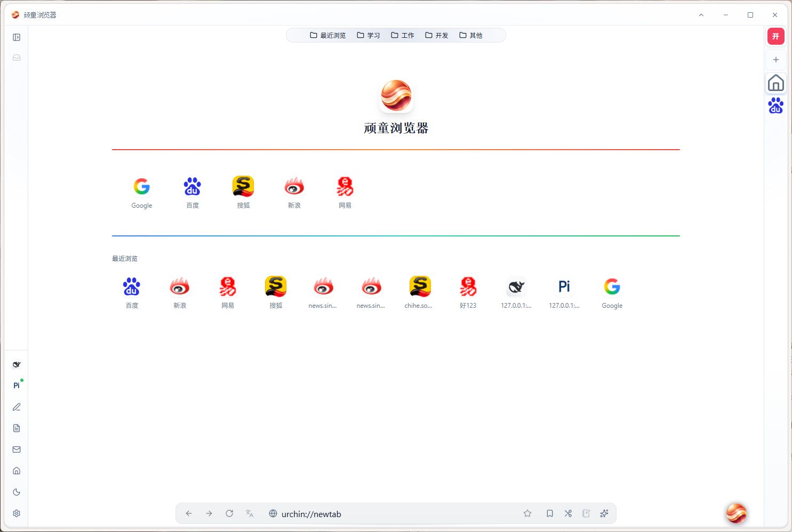
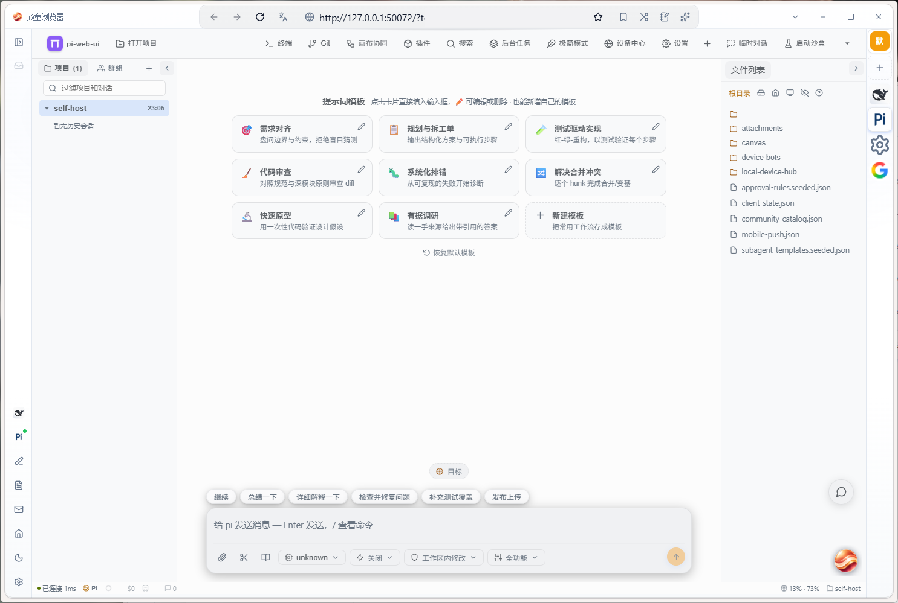
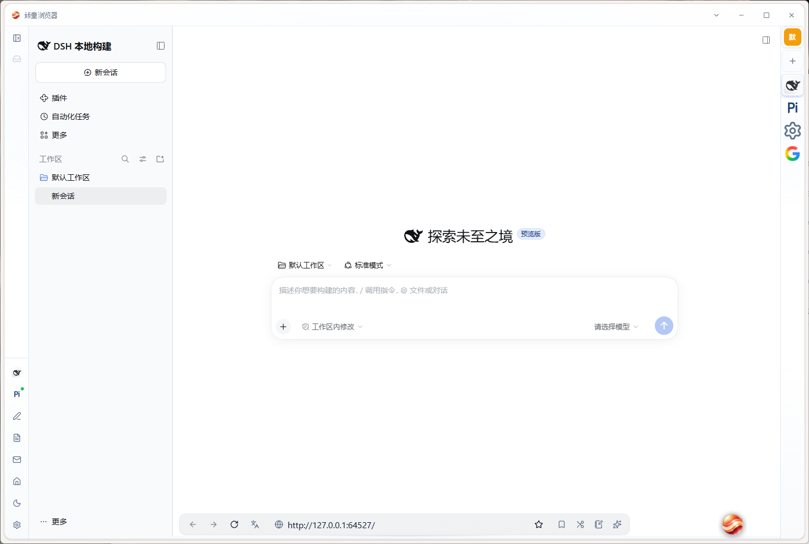
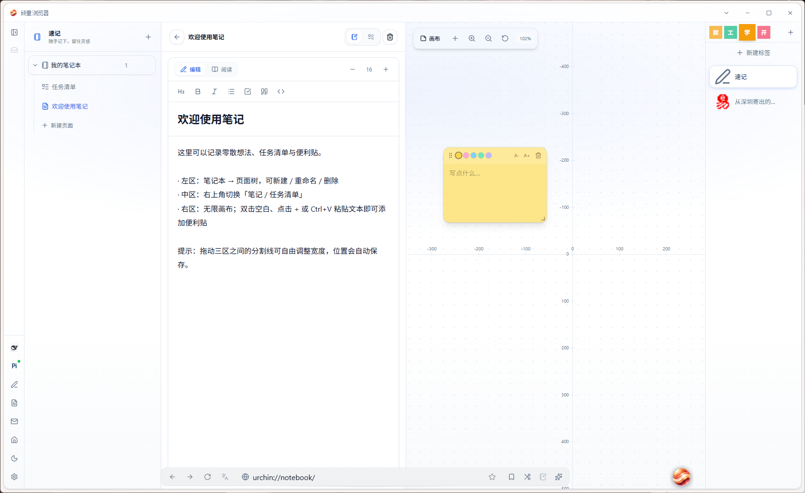
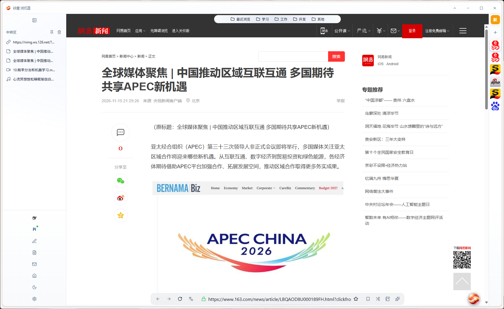
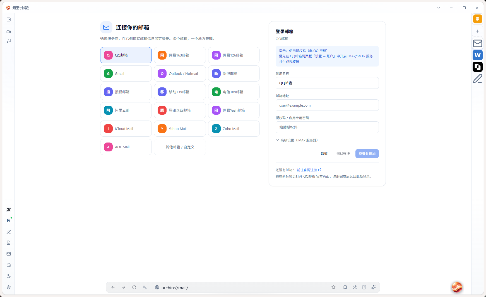
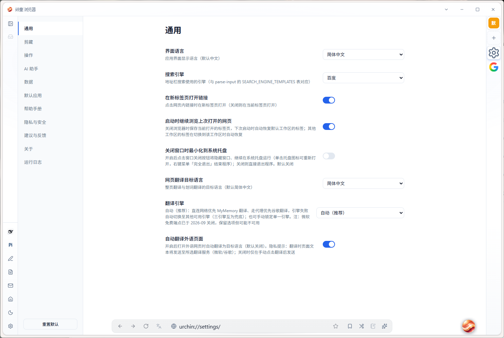

# 顽童浏览器（Urchin Browser）

> AI 原生 + 开发者友好的桌面浏览器，基于 Electron / 完整 Chromium 内核。

**当前阶段**：v0.1.0 里程碑（2026-07-29，MVP 最小闭环 + per-provider 强隔离架构）后持续迭代；代码版本以 [CHANGELOG.md](./CHANGELOG.md) 表尾为准（本行更新于 2026-11-18，当前稳定版 v0.3.0）。已交付 GenOffice 六编辑器融合、pi-web、网页翻译（M24）、网页剪藏（M26）、笔记/便利贴（M27）、本地文件查看/编辑、应用内自动更新、M15 DevTools 检视面板、M25 邮箱、多工作区（TP7）等能力，逐条记录见 [CHANGELOG.md](./CHANGELOG.md)。安装包见 [GitHub Releases](https://github.com/sgobiorodolfo170-ai/Urchin-Browser/releases)（主发布源与自动更新）或 [AtomGit 国内镜像](https://atomgit.com/daichuanmu/Urchin-Browser/releases)（手动下载）。

## 界面预览

### 从清爽主页开始

常用网站、最近浏览与书签栏集中呈现，功能入口分布在两侧，为网页内容留出空间。



### 多个工作区，一屏切换

用缩略图总览区分工作、学习和开发场景，随时回到各自的浏览环境。


### AI 助手与日常工具

<table>
  <tr>
    <td width="50%">
      <strong>Pi 编程工作台</strong><br />
      提示词模板、项目、终端与 Git 等工具集中在一个标签页。
      <a href="./docs/screenshots/03-pi-workbench.png"></a>
    </td>
    <td width="50%">
      <strong>DeepSeek Harness</strong><br />
      在浏览器内打开 DSH，管理工作区、会话、插件与自动化任务。
      <a href="./docs/screenshots/04-deepseek-harness.png"></a>
    </td>
  </tr>
  <tr>
    <td width="50%">
      <strong>速记与画布</strong><br />
      笔记本、任务清单与多媒体画布并排，集中整理文字、图片和音视频素材。
      <a href="./docs/screenshots/05-notebook-canvas.png"></a>
    </td>
    <td width="50%">
      <strong>浏览与中转区</strong><br />
      阅读网页时，将链接、文字、文件及音视频素材集中到左侧中转区。
      <a href="./docs/screenshots/06-transit-panel.png"></a>
    </td>
  </tr>
  <tr>
    <td width="50%">
      <strong>多服务商邮箱</strong><br />
      从服务商选择到账户配置，在浏览器内连接常用邮箱。
      <a href="./docs/screenshots/07-mail.png"></a>
    </td>
    <td width="50%">
      <strong>按习惯调整浏览器</strong><br />
      语言、搜索、启动恢复、托盘和网页翻译等选项集中设置。
      <a href="./docs/screenshots/08-settings.png"></a>
    </td>
  </tr>
</table>

截图摄于 2026-11-15；点击图片可查看原尺寸。

## 项目定位

- **内核**：Electron 内置完整 Chromium（Blink + V8）
- **首版平台**：Windows
- **差异化双定位**：
  - AI 原生——Side Panel 始终在侧，理解当前页面上下文，无需复制粘贴到外部 LLM
  - 开发者友好——F12 打开完整原生 DevTools 独立窗口，本机 Win11 P0 已验收；Win10 延期候补；见[验收报告](./docs/开发者工具P0验收-Win11-2026-11-16.md)，路线见 [ADR-022](./docs/decisions/ADR-022-原生DevTools与专属调试增强.md)
- **Provider 中立**：用户自带 API key 或本地 LLM，浏览器不绑定任何提供方

## 下载与安装

Windows x64 安装包（NSIS，支持覆盖升级）：

| 渠道                  | 地址                                                             | 用途                             |
| --------------------- | ---------------------------------------------------------------- | -------------------------------- |
| GitHub Releases（主） | <https://github.com/sgobiorodolfo170-ai/Urchin-Browser/releases> | 主发布源、应用内自动更新源       |
| AtomGit 国内镜像      | <https://atomgit.com/daichuanmu/Urchin-Browser/releases>         | 国内手动下载，资产与 GitHub 相同 |

- 最新稳定版：[GitHub v0.3.0](https://github.com/sgobiorodolfo170-ai/Urchin-Browser/releases/tag/v0.3.0) / [AtomGit v0.3.0](https://atomgit.com/daichuanmu/Urchin-Browser/releases/tag/v0.3.0)
- 稳定版与开发版（`vX.Y.Z-dev.NNN`）均双库发布；开发版在 GitHub 标记为 Pre-release。
- 代码、Issue、Pull Request 以 GitHub 为唯一真源；AtomGit 为**只读代码镜像**（由平台 Pull 镜像自动同步），不提 Issue / PR。
- 应用内自动更新只查询 GitHub Releases，不依赖 AtomGit。

## v0.1 功能概览

| 模块                       | 范围                                                                                                                              |
| -------------------------- | --------------------------------------------------------------------------------------------------------------------------------- |
| M1 Window Lifecycle        | 完整（多窗口管理 + 单实例锁 + 窗口尺寸记忆）                                                                                      |
| M2 Tab Manager             | 完整（BrowserView + GenOffice WebContentsView 混挂 + 事件同步 + 持久化）                                                          |
| M3 Navigation Stack        | 完整（loadUrl/stop/back/forward/reload）                                                                                          |
| M4 Omnibox                 | 完整（URL 解析 + 历史/书签合并补全 + 安全协议拦截 + 本地路径识别）                                                                |
| M5 Bookmarks               | 完整（CRUD + 收藏夹面板）                                                                                                         |
| M6 History                 | 完整（查询 + 去重 + 访问计数）                                                                                                    |
| M7 Settings                | 完整（分层默认值 + 跨进程同步 + 数据目录/默认应用等设置页）                                                                       |
| M8 Storage Layer           | SQLite WAL + safeStorage 加密 + LRU 连接池 + 数据目录可配置（pi 数据独立）                                                        |
| M10-lite Extension Loader  | 基础（MV3 manifest 校验 + 目录加载 + 生命周期）                                                                                   |
| M11 AI Orchestrator        | 完整（per-provider 子进程隔离 + 心跳 + 限流 + 重试 + 流式）                                                                       |
| M12 Provider Plugin API    | 完整契约 v1                                                                                                                       |
| M13 AI Side Panel          | demo（流式对话 + 页面上下文注入；`urchin://ai` 入口现由 pi-web 启动器承载）                                                       |
| M14 Page Context Extractor | demo（Readability 正文抽取）                                                                                                      |
| M15 DevTools Enhancement   | 原生 F12 与旧链路退出完成，本机 Win11 P0 已验收；Win10 候补，P1 未启动，见[验收报告](./docs/开发者工具P0验收-Win11-2026-11-16.md) |
| M17 IPC Protocol           | 完整（类型化 RPC + MessagePort 流式 + 事件推送）                                                                                  |
| M18 Permission/Sandbox     | 完整（sandbox + contextIsolation + preload）                                                                                      |
| M19 Theme/UI System        | 基础（暗色/亮色 + Radix + Tailwind）                                                                                              |
| M23 Download Manager       | 完整（will-download 接管 + 保存对话框 + 进度 + 暂停/取消）                                                                        |
| M24 网页翻译               | 完整（谷歌/微软双引擎兜底 + 整页替换/恢复 + 划词翻译 + 自动翻译开关）                                                             |
| M20 Update Service         | 完整（dev.114 提前：electron-updater + GitHub dev 预发布通道 + dev→stable 两段检查）                                              |
| M25 邮箱                   | 基础（2026-09-29 交付：IMAP 收信 + SMTP 发信 + MIME 解析 + 自建 UI）                                                              |

### dev 系列交付的其他能力（M 编号之外）

- **pi-web**：pi coding agent 网页化（启动器拉起 pi-web-ui，Electron 内置 Node 子进程 `ELECTRON_RUN_AS_NODE` + 127.0.0.1 随机端口，与主进程隔离）
- **GenOffice 编辑器融合**（ADR-009）：markdown / pdf / html / docs(docx) / slides(pptx) / sheets(xlsx) **六编辑器**嵌入标签体系 + 侧栏文档主页（dev.107-108 补齐 Slides/Sheets）
- **多工作区**（TP7，dev.116）：同一网站多账号登录，Cookie/localStorage/IndexedDB/Service Worker 全隔离、持久化、可切换
- **本地文件查看器/编辑器**：打开入口 ×4（侧栏按钮 / Ctrl+O / 拖放 / 地址栏路径）、文件夹浏览、Tiptap 富文本编辑
- **截图**（整屏框选裁剪保存）、**Windows 文件关联**（可设为默认打开方式）、**网页右键菜单**（复制/粘贴/保存网页）
- **Ctrl+滚轮缩放**、**广告浮窗屏蔽**（默认开）等体验能力
- **应用内自动更新**（dev 预发布通道；稳定版发布后 dev 无更新时可迁移到 stable）

## 快速开始

### 环境要求

- Node.js ≥ 22
- pnpm ≥ 9
- Windows 10/11（macOS/Linux 待 v0.4+）

### 安装依赖

```bash
pnpm install
```

### 开发模式

```bash
pnpm dev
```

### 构建

```bash
pnpm build
```

### 打包 Windows 安装包

```bash
pnpm package:win
```

产出位于 `apps/desktop/release-v24/`（NSIS 安装包 + win-unpacked 目录；目录名随 electron-builder 配置版本递增）。

## 开发命令

| 命令                      | 说明                                                                                      |
| ------------------------- | ----------------------------------------------------------------------------------------- |
| `pnpm dev`                | 开发模式（vite dev server）                                                               |
| `pnpm build`              | 构建 main / preload / renderer                                                            |
| `pnpm start`              | 生产模式启动已构建产物                                                                    |
| `pnpm verify`             | 可选全链验证，由模型按风险决定是否运行（组成真源：根 `package.json` 的 `scripts.verify`） |
| `pnpm typecheck`          | 全工作区 TypeScript 类型检查                                                              |
| `pnpm lint`               | ESLint 检查                                                                               |
| `pnpm test`               | 全工作区单元测试                                                                          |
| `pnpm test:coverage`      | 单元测试 + 覆盖率报告                                                                     |
| `pnpm e2e`                | Playwright E2E 全量（CI 入口；本地由模型判断是否需要全量）                                |
| `pnpm e2e:select`         | **本地按需选择 E2E**（可选推荐表 + 模型自主选例；允许跳过）                               |
| `pnpm check:e2e-manifest` | E2E manifest 与 spec 文件双向一致（G20）                                                  |
| `pnpm genoffice:build`    | 重建 GenOffice 编辑器嵌入产物                                                             |
| `pnpm package:win`        | 打包 Windows 安装包                                                                       |
| `pnpm format`             | Prettier 格式化                                                                           |

## 性能与质量指标

**v0.1.0 首发验收**（2026-07-29，W7-W8 实测）：

| 指标              | 阈值     | 实测                                   |
| ----------------- | -------- | -------------------------------------- |
| 冷启动时间（P95） | ≤ 3000ms | 1011ms ✓                               |
| 10 标签内存       | ≤ 500MB  | 358.3MB ✓                              |
| 单元测试          | 全过     | 457 passed ✓                           |
| 覆盖率（Stmts）   | ≥ 60%    | 68.05% ✓                               |
| E2E 关键路径      | 全过     | 全绿（当时基线：启动/导航/开关标签） ✓ |

**当前（v0.2.0 stable，2026-10-27 实测）**：

| 指标                                     | 阈值（v0.2 阶梯）  | 实测                                                                                              |
| ---------------------------------------- | ------------------ | ------------------------------------------------------------------------------------------------- |
| 单元用例（无集成层，见 AGENTS.md §八.1） | 全过               | 1428 passed（120 文件）✓                                                                          |
| 覆盖率（Lines）                          | ≥ 65%              | 69.03% ✓（branch 79.57% / funcs 77.12%）                                                          |
| E2E 关键路径                             | 全过               | **23 个 spec / 38 例**（本地 36 passed + 2 skipped；CI run 42803495499 = 35 passed / 3 skipped）✓ |
| 10 标签内存（perf.spec）                 | 目标 500MB（告警） | 本机 707.7~740.2MB（回归线 800）/ CI 567.4MB（回归线 750）                                        |

> 覆盖率门槛由 `apps/desktop/vitest.config.ts` 的 `coverage.thresholds` 强制（低于门槛 `pnpm verify` 失败），数值真源见 [docs/03-技术栈 §4](./docs/03-技术栈.md)。逐次验收数字见 [CHANGELOG.md](./CHANGELOG.md)。

## 文档

完整设计文档体系位于 [`docs/`](./docs/文档索引.md)，覆盖：

- 产品定位与决策记录（[01](./docs/01-愿景与定位.md)）
- 架构与进程模型（[02](./docs/02-架构设计.md)）
- 技术栈与覆盖率门槛（[03](./docs/03-技术栈.md)）
- 模块全景与 v0.1 范围（M1-M27 + 非编号能力，[04](./docs/04-模块全景.md)）
- 11 份接口契约（[Provider API / IPC / Chrome 兼容 / Tab Manager 等 A-K](./docs/contracts/)）
- 决策留痕：14 份 ADR（截至 2026-11-11）+ 全项目决策总索引（缺号说明与计数口径见 [决策索引](./docs/decisions/决策索引.md)）

## 开发规范

项目根目录的 `AGENTS.md` 是 AI Agent 全流程开发规范，**项目级适配已于 2026-07-29 完成并生效**（量化门槛/工具名/流程裁剪，适配留痕见其「项目适配说明区」）。测试覆盖率门槛的单一真源为 [docs/03-技术栈 §4](./docs/03-技术栈.md)。

## 架构亮点

- **per-provider 强隔离**：每个 AI Provider 运行在独立子进程（utility process），crash 不影响浏览器主进程
- **Provider 中立**：支持本地路径/npm 包加载第三方 Provider，版本协商 + 安全 warning 流程
- **GenOffice 视图级融合**：编辑器以独立 WebContentsView 嵌入标签体系，宿主只依赖自包含嵌入包（不 import vendor 依赖树），产物缺失自动回落内置查看器
- **pi 进程外运行**：pi coding agent 全部运行于 Electron 内置 Node（`ELECTRON_RUN_AS_NODE`）子进程，Electron 主进程零 pi 依赖
- **类型化 IPC**：zod schema 双向验证 + MessagePort 流式传输
- **SQLite 加密存储**：WAL 模式 + safeStorage 加密 + per-provider/per-extension 命名空间隔离

## License

详见 [LICENSE](./LICENSE)。
