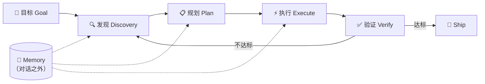

# AI Agent 开发规范与方法论

> 本文档定义一套以 AI Agent 为执行主体的全流程开发规范，覆盖沟通标准、编码自审、测试验收、质量门禁、循环工程与图谱工程。供 AI Agent 与人类协作者共同遵循。

**目录**（章节序号已是跨文档引用接口——14 个文档共 40 处 `agents.md §X` 引用，重排前请先检索）

[项目适配说明区](#项目适配说明区按-〇5-要求留痕) · [工作流约定](#工作流约定每次修改后自动运行验证2026-09-20-用户指令) · [项目声明](#项目声明2026-08-17-确立urchin-browser-正式声明) · [〇 文档性质](#〇文档性质与使用条款) · [一 总纲](#一总纲全流程-ai-驱动开发) · [二 CRTSE](#二crtse-提示词框架人机协作沟通标准) · [三 任务跟踪](#三任务进度跟踪时时有记录事事有记录) · [四 版本迭代](#四版本迭代记录版本号--摘要) · [五 自动提交](#五自动化-git-提交与版本号自增) · [六 三步自审](#六code-review-三步自审法) · [七 注释规范](#七代码注释规范) · [八 测试覆盖](#八测试覆盖) · [九 质量护栏](#九质量护栏quality-guardrails) · [十 Loop Engineering](#十loop-engineering工作循环工程) · [十一 Graph Engineering](#十一graph-engineering图谱工程) · [附 速查表](#附规范全景速查) · [AOCI](#aoci-仓库认知)

**分层加载**（全文约 2.4 万 token，不必每次全读；按下列优先级取用，必读面约 60 行 / 6 千 token）

| 层级       | 章节                                                                                                          | 何时读                                                                                               |
| ---------- | ------------------------------------------------------------------------------------------------------------- | ---------------------------------------------------------------------------------------------------- |
| **必读**   | §一 核心原则 · §六 三步自审（含与 §一 的分工）· §八.2 覆盖率门槛 · §九.2 卡点 + §九.4 硬门禁清单 · 工作流约定 | 每次会话开工前                                                                                       |
| **按需**   | §二 CRTSE（下指令时）· §三/§四/§五（留痕、提交、版本）· §七 注释规范 · §十 Loop Engineering                   | 触发对应动作时                                                                                       |
| **参考**   | §十一 Graph Engineering（已裁剪）· §〇 文档条款 · 项目声明 · 附 速查表                                        | 改规范或争议裁决时                                                                                   |
| **可跳过** | 文末 AOCI 区块（`<!-- aoci:begin -->`…`<!-- aoci:end -->`）                                                   | 由 aoci 工具注入，服务对象是宿主的仓库认知流程，不是人类阅读材料；权威源为 `aoci_rules` 与实时 Guide |

---

## 项目适配说明区（按 §〇.5 要求留痕）

| 项         | 值                                                                                                                                                    |
| ---------- | ----------------------------------------------------------------------------------------------------------------------------------------------------- |
| 适配日期   | 2026-07-29（最近复核 2026-10-27，修订记录见本节末）                                                                                                   |
| 适配人     | WorkBuddy Agent（D8 议题，经用户指令启动）                                                                                                            |
| 适配项目   | Urchin Browser——Electron 系 AI 原生 + 开发者友好桌面浏览器（首版 Windows，pnpm monorepo）                                                             |
| 架构性变更 | **无**——本次适配全部为条款允许的「填充细化 / 门槛校准 / 流程裁剪」，未触碰 §〇.3 修改红线                                                             |
| 关联文档   | [docs/文档索引](docs/文档索引.md)（设计文档体系 v0.0.2+）、[docs/03-技术栈](docs/03-技术栈.md)、[docs/decisions/决策索引](docs/decisions/决策索引.md) |

**主要调整项**：

1. **§八 覆盖率门槛**：模板默认值 → 项目逐版本阶梯（v0.1 ≥60% → v1.0 ≥80%），原值/适配值/理由见 §八.2，数值单一真源为 [docs/03-技术栈 §4](docs/03-技术栈.md#4-测试覆盖率适配门槛)。
2. **§九 质量护栏**：通用工具名 → 项目实际选型（ESLint 9 / Prettier 3 / Vitest 2 / Playwright / Husky + lint-staged / commitlint / GitHub Actions）。
3. **§二/§三/§四/§五/§六 术语本地化**：Electron 三层进程模型、[docs/](docs/文档索引.md) 设计文档体系、M1-M25 模块编号、zod 契约边界。
4. **§十一 Graph Engineering**：按项目规模裁剪（当前单仓库、已交付模块 25 个 <50；重启评估触发条件见 §十一 开头）。
5. **流程裁剪**：PR 评审卡点 → CI 流水线卡点（pre-commit hook + GitHub Actions），发布保留人工确认门禁（与 [docs/03-技术栈 §5](docs/03-技术栈.md#5-cicd-门槛v01) 一致）。
6. **2026-08-17 新增「项目声明」章节**：确立「生产级标准 + 长期迭代承诺」正式声明（见下方「项目声明」）。性质为对既有条款的**明示与固化**（填充细化），未新增、未修改任何架构性约定。
7. **2026-09-20 新增「工作流约定」章节**：每次修改后自动跑 `pnpm verify`，UI/交互变更追加 `pnpm e2e`，收尾构建并启动供人工验收。性质为**执行约定**（填充细化），未修改任何架构性条款。
8. **2026-09-29 追加 AOCI 仓库认知区块**：`<!-- aoci:begin -->` 至 `<!-- aoci:end -->`（文末）由 aoci 工具托管，规定仓库认知的建立、复用与维护原则；其权威源为 `aoci_rules` 与实时 Guide，本文件只保留接入、使用与收尾原则，不承载完整手册。**2026-10-27 评估结论：不物理外移**——该区块由 aoci 工具按 `.aoci/config.json` 的 `installed_agents: ["opencode"]` 注入到本文件，手工搬走会在下次 aoci 运行时重复注入；故仅在文档头「分层加载」表中标注为「可跳过」，位置保持不变。真正减重需改 aoci 侧注入配置，属独立决策。
9. **2026-10-26 §十一 复核**：模块口径由「规划 23 个」更新为「已交付 25 个（M1-M25）」，裁剪决定维持不变。

**文档修订记录**（§〇.5「适配产出要求」要求记录适配日期与主要调整项，本节为该要求的落地台账）：

| 日期       | 变更摘要                                                                                                                                                                                                                                                                         | 架构性变更                                                                              | 授权来源                                                      |
| ---------- | -------------------------------------------------------------------------------------------------------------------------------------------------------------------------------------------------------------------------------------------------------------------------------- | --------------------------------------------------------------------------------------- | ------------------------------------------------------------- |
| 2026-07-29 | 首次项目适配：覆盖率门槛阶梯化、质量护栏工具链本地化、术语本地化、§十一 裁剪                                                                                                                                                                                                     | 无                                                                                      | 用户指令（D8 议题）                                           |
| 2026-08-17 | 新增「项目声明」（生产级标准 + 长期迭代承诺）                                                                                                                                                                                                                                    | 无                                                                                      | 用户指令                                                      |
| 2026-09-20 | 新增「工作流约定」（改后自动验证 + 构建启动验收）                                                                                                                                                                                                                                | 无                                                                                      | 用户指令                                                      |
| 2026-09-29 | 追加 AOCI 仓库认知区块（工具托管）                                                                                                                                                                                                                                               | 无                                                                                      | 用户指令                                                      |
| 2026-10-26 | §十一 复核（模块口径 23→25）；版本/决策计数/能力口径对齐 dev.121                                                                                                                                                                                                                 | 无                                                                                      | 既有条款内修正                                                |
| 2026-10-27 | 一致性整改：模块数对齐、命令统一为 `test:coverage`、pre-commit 链路如实描述、补目录与修订记录                                                                                                                                                                                    | 无                                                                                      | 用户指令（评估报告整改）                                      |
| 2026-10-27 | **§一 / §六 分工澄清**：明确「三步自审 = 提交前过滤，不构成验收」「独立验证 = 验收唯一依据」，消除两处互斥表述；新增 §〇.6 条款强制级别、§九.4 硬门禁清单                                                                                                                        | **是**（方法论层表述；未删除任何条款、未改三步顺序与三层结构、未削弱独立验证）          | **用户明确授权**（2026-10-27，整改第三批，§〇.4 第 5 步留痕） |
| 2026-10-27 | **第二轮整改**：止血 10 处（错命令/错卡点描述/E2E 基线/README 口径）；建立 [docs/事实登记表](docs/事实登记表.md) + `check:docs` 漂移门禁（G13/G15）；提交追溯门禁（G14）；分层覆盖率门槛（Tab Manager / Provider 契约）；§七 注释降级 SHOULD；§三 任务载体明确；§十一 补计数口径 | 部分（§七 降级、§十一 计数口径属条款语义调整，均在 §〇.3 允许的填充细化内；无条款删除） | 用户指令「按规划整改」（2026-10-27）                          |

---

## 工作流约定：每次修改后自动运行验证（2026-09-20 用户指令）

> 用户指令原文：「每次修改完后都需要自动运行我测试下」。本条为**执行约定**（填充细化），不修改任何架构性条款。

**AI Agent 强制流程**：

1. **每次代码修改完成后，必须自动执行** `pnpm verify`（= `typecheck` + `lint` + `test:coverage` + `check:docs`，**含覆盖率门禁与文档漂移检查**），并在回复中附上结果摘要（通过/失败与关键数字）；失败必须先修复再继续。
2. **涉及 UI / 交互 / 主进程行为变更**时，在 `pnpm verify` 通过后**追加** `pnpm e2e`（或对应 spec 单跑）验证真实 Electron 行为。
3. **需要人工验收的改动**（界面、交互、视觉），在验证通过后**构建并启动应用**：`pnpm run build` 后执行 **`pnpm start`**（生产模式启动已构建产物，脱离本会话后台运行；直接 `electron .` 未带 `NODE_ENV=production` 会走 dev 分支连 vite dev server 导致白屏）。启动后在回复中说明如何操作。
4. 涉及打包/资源/依赖变更时，额外跑 `pnpm package:win`（本机需 `ELECTRON_MIRROR` 与 `ELECTRON_BUILDER_BINARIES_MIRROR` 指向 npmmirror）。
5. 本条与 §一「独立验证」、§九「质量护栏」、§十「Loop Engineering 停止条件」一致：验收信号必须来自确定性检查，不接受 AI 自评。
6. **任务完成后必须先运行项目供用户测试**：验证（1-4）全部通过后，**构建并启动应用**（`pnpm run build` 后执行 `pnpm start`，后台运行脱离本会话），让用户实际操作验收后再结束。此为强制收尾步骤，不得省略。涉及 genoffice shell 源码变更时，先跑 `node scripts/genoffice-build.mjs shell` 重建 shell 产物再构建启动。

---

## 项目声明（2026-08-17 确立，Urchin Browser 正式声明）

> 本声明由用户指令确立：**本项目以生产级标准开发与验收，相关规范与约定要能够满足长期迭代需求。**
> 性质：本声明对既有条款做**明示与固化**，不新增、不修改任何架构性约定（属 §〇.3 允许的「填充细化」），与 §〇.1「本项目状态」、§〇.3「修改红线」不冲突。

**声明一 · 开发标准——生产级是全过程标准，而非 v1.0 目标**

- 生产级标准**自 v0.1 起全程适用**，不因版本早期而豁免：质量护栏（§九：lint / typecheck / 单测+覆盖率门禁 / E2E）、覆盖率阶梯（§八.2）、类型安全（strict + noUncheckedIndexedAccess）、进程隔离（§六 项目特化审查点）、安全基线（safeStorage 凭据加密 / zod 跨边界校验 / 扩展权限白名单）均为强制项。
- 每版本交付物（代码、契约、文档、安装包）均须经受声明的质量要求后放行；「原型阶段」「MVP」等阶段定位只缩小**范围**，不降低**标准**。

**声明二 · 验收标准——一切交付以确定性信号验收**

- 完成与否以可机器判定的 0/1 信号判定（typecheck / lint / 单测与覆盖率门禁 / E2E 全绿），验收标准即测试（§八.4），不接受 AI 自评（§一「独立验证」）。
- 每版本验收准则见 [docs/05-路线图 §2](docs/05-路线图.md#2-每版验收准则可机器判定)；测试约定见 [docs/03-技术栈 §7](docs/03-技术栈.md#7-测试约定)。

**声明三 · 长期迭代承诺——规范与约定是约束性基线**

- **可追溯**：决策留痕（§三，[docs/decisions/决策索引](docs/decisions/决策索引.md)）、版本迭代（§四，CHANGELOG.md）、结构化提交（§五）全程强制。
- **可演进**：SemVer + v1.0「公开 API 稳定」冻结承诺（[docs/05-路线图 §3](docs/05-路线图.md#3-版本节奏的-semver-含义)）、覆盖率阶梯逐版本提升（§八.2）、Graph Engineering 按规模重启评估（§十一 触发条件）为演进而非废弃留出路径。
- **可维护**：三级注释体系（§七）、三步自审法（§六）、契约 zod schema 单一真源（[docs/03-技术栈 §2](docs/03-技术栈.md#2-辅助依赖最小集)）保证后续接手者与后续版本可持续维护。
- **可复核**：每次版本收口须对照本声明复核规范适配性；任何量化门槛 / 流程 / 架构约定的调整仍须走 §〇.3 修改红线与 §〇.4 权限请求机制，不得以「生产级要求」为由绕过既有流程。

---

## 〇、文档性质与使用条款

**定义**：本文件是一份**通用模板文档（Template）**，定义 AI Agent 全流程开发的方法论骨架与最低规范基线，而非针对某一具体项目的定制规范。

### 1. 文档定位

- 本文档是 **agents 模板**，所有章节均为跨项目通用的架构性约定。
- 用户将本文档放入具体项目后，它即成为该项目的 **开发规范起点**，需经项目适配后正式生效。
- **本项目状态**：已于 2026-07-29 完成项目适配（见上方「项目适配说明区」），本文件自此作为 Urchin Browser 的正式开发规范生效。
- 文档中的「定义」「核心原则」「门槛」「流程」属于**架构性内容**，是规范的骨架，不可随意删改。

### 2. AI 工具的适配义务

当本文档被放入项目后，接入的 AI 工具**必须**在首次使用前完成**项目适配性优化**，使其贴合当前项目的技术栈、规模与约束：

| 适配项     | 说明                                                         | 示例                                                           |
| ---------- | ------------------------------------------------------------ | -------------------------------------------------------------- |
| 技术栈对齐 | 将通用工具名替换为项目实际选型                               | 「ESLint/Pylint」→ 项目实际使用的 lint 工具                    |
| 门槛校准   | 根据项目阶段与团队规模调整量化指标                           | 测试覆盖率 ≥80% → 早期项目可降至 ≥60%，需注明过渡计划          |
| 流程裁剪   | 按项目实际工作流保留或简化章节                               | 单人项目可简化「PR 评审」为「自审提交」                        |
| 术语本地化 | 统一为项目内既有命名与约定                                   | 命名风格、目录结构、错误类型等                                 |
| 依赖完整性 | 适配时不得破坏章节间的显式依赖关系（见各章节「⚠ 依赖」标注） | 修改第四节版本号规则时，必须同步校验第五节自增映射是否仍可执行 |

### 3. 修改红线（架构性内容保护）

适配性优化**仅限填充与细化**，**不得违背本文档的总体架构性约定**。以下内容属于受保护范围，AI 工具不得自行变更：

**方法论层**：

- 总纲的**核心原则**（目标前置 / 小步快跑 / 时时有记录 / 独立验证 / 不确定性上报 / 上下文边界 / 不可逆操作审批 / 自审）
- 各章节的**定义**与**核心原则**
- CRTSE **五要素结构**及其完整性

**流程层**：

- 三步自审法的**审查顺序与三层结构**（允许按变更类型匹配审查轮次）
- 测试覆盖的 **TDD 流程**（先测试后代码——写测试→跑红→实现→跑绿→重构，允许简化「跑红」步骤）
- Loop Engineering 的**核心循环**（Goal→Discovery→Plan→Execute→Verify→Ship/Iterate）与五大设计杠杆
- 质量护栏的**四大类型**与**全流程卡点**框架

**规范层**：

- **版本号规则必须是确定的、可机器判定的**（SemVer 为默认推荐，不强制）
- **提交信息必须结构化，包含变更类型和简短描述**（Conventional Commits 为默认推荐，不强制）
- **代码结构理解机制**的必要性（Graph Engineering 为高阶实现——中大型项目强制，小型项目允许裁剪）

> 允许：在架构骨架内填充项目细节、动态调整量化门槛、裁剪不适用的子项。
> 禁止：删除整个章节、改变方法论的阶段顺序、绕过验收驱动的核心逻辑、让 AI 模型自行评价自身产出。

### 4. 修改权限请求机制

若 AI 工具在适配过程中判断**必须进行架构性修改**才能适配项目（例如项目范式与某章节根本冲突），**不得自行修改**，必须执行以下流程：

完整权限请求流程（团队项目/正式项目，5 步）：

1. **停止修改**，不得擅自删改受保护内容；
2. **向用户说明冲突点**：指出哪一章节、哪一条架构性约定与项目实际情况冲突；
3. **提出修改方案**：给出建议的调整方向、理由及潜在影响；
4. **请求用户授权**：明确告知"此修改属于架构性变更，需要您确认"，等待用户明确同意后方可执行；
5. **记录变更**：获得授权后执行的架构性修改，须在项目适配版本中标注变更原因与授权来源，留痕可追溯。

> 📎 **简化模式**：单人项目或 prototype 阶段可采用核心 3 步——停止修改 → 向用户说明冲突并请求授权 → 记录变更。跳过完整方案阐述和来源追溯，但「获得用户确认」这一步不得简化。

### 5. 适配产出要求

适配完成后的文档必须：

- 保留原文档的**章节编号与标题结构**，便于对照模板追溯；
- 在文档头部或适配说明区**必须**记录：适配日期、适配人/Agent、主要调整项、是否含架构性变更（及授权记录）；
- 对调整过的量化门槛，**必须**注明原模板值与适配值，以及调整理由；
- 在速查表中**必须**标注哪些章节经过适配修改（见末尾「规范全景速查」表的「适配标记」列）。

### 6. 条款强制级别（MUST / SHOULD / MAY）

**定义**：全文条款按强制力分三级。此前全文使用「必须」51 次、「不得」35 次、「强制」13 次而未分级，导致执行时无法判断轻重缓急——所有条款都「必须」，等于没有必须。

| 级别                 | 含义                       | 违反后果                                       | 全文标识                                          |
| -------------------- | -------------------------- | ---------------------------------------------- | ------------------------------------------------- |
| **MUST（硬门禁）**   | 违反即阻断交付，由机器判定 | 提交/合并/发布被拦，或交付判定为不通过         | 「必须」「不得」「禁止」+ 出现在 §九.4 硬门禁清单 |
| **SHOULD（强推荐）** | 默认执行，偏离须说明理由   | 不阻断，但须在提交信息或决策记录中写明偏离原因 | 「应」「默认」「推荐」                            |
| **MAY（可选）**      | 按项目阶段与成本取舍       | 无后果                                         | 「可」「允许」「按需」                            |

**执行规则**：

- 判断一条要求是 MUST 还是 SHOULD，**不看用词，看是否可机器判定**：能被 CI / hook / 测试判定的才是 MUST；需要人判断的是 SHOULD。
- MUST 条款必须逐条登记到 §九.4 硬门禁清单，未登记的不具备阻断力——避免出现「文档写了必须、实际无人执行」的空转条款。
- 新增 MUST 条款时须同时说明由哪一步卡点执行，否则降级为 SHOULD。

---

## 一、总纲：全流程 AI 驱动开发

**定义**：以 AI Agent 为执行主体，贯穿软件全生命周期（需求 → 设计 → 编码 → 自审 → 测试 → 提交 → 发布）的开发模式。人类从"逐行执行者"退到"设目标、定边界、验结果"的位置。

| 角色         | 职责                                                       |
| ------------ | ---------------------------------------------------------- |
| **人类**     | 设定目标与验收标准、定义边界与约束、最终验证与决策         |
| **AI Agent** | 拆解任务、生成代码、自审重构、编写测试、迭代修复、记录进度 |

**核心原则**：

- **目标前置**：每次开工先把目标和验收标准说清楚，验收必须是可机器判定的 0/1 信号。不可由 AI 自行判断"是否做完"。
- **小步快跑**：每次只做最小可验证的改动，跑通验证再扩展。
- **时时有记录**：任务进度、设计决策、迭代摘要全部落盘，独立于对话存在。
- **独立验证**：**验收判定**必须由独立于执行者的确定性检查（typecheck / lint / 测试 / E2E）给出，或由独立模型、人类执行；不允许 AI 用自评结论充当验收信号。**注意分工**：§六 的三步自审是执行者本人的「提交前过滤」，不构成验收——自审通过 ≠ 验收通过，验收结论不得引用自审结论（分工定义见 §六 开头）。
- **不确定性上报**：AI 在执行任何任务时，若对需求理解、方案可行性、工具用法、依赖版本的置信度低于阈值（默认 80%），必须主动向人类报告不确定项，不得自行猜测填充。Loop 内连续两次迭代未取得进展时，必须暂停并上报。
- **上下文边界**：AI 的操作范围严格限定在当前任务所需的最小文件集和符号集。禁止对未在任务描述中提及的模块进行任何形式的修改（包括重构、格式化、注释增删），除非先请求授权并获得确认。
- **不可逆操作审批**：涉及生产环境变更、数据库写操作、权限修改、文件删除、对外发布等不可逆操作，AI 不得自行执行。必须生成变更方案和影响评估后，等待人类明确确认方可执行。本原则优先于一切效率优化诉求。
- **自审**：对产出代码执行 Code Review 后再提交。审查轮次和深度按变更类型匹配——简单变更可简化，架构级变更必须完整三轮。
- **关联**：「时时有记录」与第十节 Loop Engineering 的「Memory 活在对话之外」是同一理念的两个层次——前者是**方法论要求**（必须落盘），后者是**技术实现**（文件 / 结构化状态记录），AI 工具不得只取其一。「独立验证」与第十节「验收信号必须是确定性检查」是同一原则的两个表述。

---

## 二、CRTSE 提示词框架：人机协作沟通标准

**定义**：编写 AI 提示词的五要素结构（Context-Role-Task-Standards-Examples），确保 AI 输出可预期、可复用、可复现。这是与 AI 协作的基础方法论。

| 要素                   | 含义                                         | 示例                                                                                                                |
| ---------------------- | -------------------------------------------- | ------------------------------------------------------------------------------------------------------------------- |
| **C** — Context 上下文 | 交代技术栈、项目类型、当前架构、相关约束     | "本项目为 Electron + React + TypeScript 桌面浏览器，主进程 / 渲染进程 / utility 进程三层架构，SQLite 持久化"        |
| **R** — Role 角色      | 指定 AI 扮演的专业身份                       | "你是一位资深桌面端工程师，精通 Electron、Chromium 多进程模型与 TypeScript"                                         |
| **T** — Task 任务      | 明确说明需求，一次提示词只对应一个核心任务   | "为 TabManager（M2）新增按窗口查询标签的方法，返回 TabSnapshot 数组"                                                |
| **S** — Standards 标准 | 定义类型安全、错误处理、代码风格等质量要求   | "全程类型安全（strict + noUncheckedIndexedAccess），跨进程边界 zod 双向校验，异常统一装箱 IpcError / ProviderError" |
| **E** — Examples 示例  | 提供现有代码库中的优秀模式或函数签名作为参考 | "参考 apps/desktop/src/main/tabs/tab-manager.ts 中事件绑定与 emit 的写法"                                           |

> 通过这套标准化工作流，可将 AI 从"一次性代码生成器"升级为深度参与软件生命周期的"智能开发助手"，大幅提升开发效率与代码质量。

> 🔗 **贯穿声明**：CRTSE 是全文的**沟通标准层**，后续所有章节（Code Review、测试覆盖、Loop Engineering 等）中凡涉及「给 AI 下达指令」的场景，均应遵循 C-R-T-S-E 五要素组织提示词。例如让 AI 执行 Code Review 时，应同时交代 R（扮演架构师）、T（审查哪段代码）、S（审查标准）。AI 工具在执行任何章节任务前，应先以 CRTSE 框架构造指令。

---

## 三、任务进度跟踪：时时有记录，事事有记录

**定义**：用结构化文档实时记录任务状态、决策与阻塞，保证任何时刻、任何接手者（人或 Agent）都能追溯项目进展。

**记录要求**：

- 每个任务记录：任务名、当前状态（待办 / 进行中 / 已完成 / 阻塞）、负责人、起止时间、产出物。
- 每个决策记录：做了什么决定、为什么这么决定、否定了哪些方案。
- 每个阻塞记录：卡在哪、影响范围、待解决事项与负责人。

**建议格式**：

```markdown
### 任务：[任务名称]

- 状态：进行中
- 负责人：Agent / 人工
- 开始：2026-07-27
- 决策记录：选用方案 A，因性能更优；放弃方案 B，因依赖过重
- 阻塞：等待第三方 API 权限审批
- 下一步：权限到位后接入联调
```

**项目落地**：决策留痕体系已建于 [docs/](docs/文档索引.md)——核心决策 58 项（首轮 36 + 迭代新增 22：T7/GR1/DD1/DL1/DB1/GF1-GF5/ML1-ML4/UP1-UP3/RC1-RC3/IM1-IM2）见 [docs/decisions/决策索引](docs/decisions/决策索引.md)，契约内决策 68 项见各契约文档末尾决策表；任务与 wave 跟踪见 [docs/04-模块全景 §4](docs/04-模块全景.md#4-v01-分波次交付计划6-8-周) 与 [docs/07-立项准备](docs/07-立项准备.md)。新增决策一律附带「否决方案理由」并分配系列 ID（D/T/IP/CP/TP/SP/PC/DT/ST/OM/TH/OR/SC，及迭代新增 GR/DD/DL/DB/GF/ML/UP/RC）。

> ⚠ **本节落地现状（2026-10-27 核实）**：仓库**没有**独立的任务看板文件——上方模板里的「任务名 / 状态 / 负责人 / 起止 / 产出物」在现有载体中只被部分承载：
>
> | 记录项            | 现有载体                                                          | 完整度   |
> | ----------------- | ----------------------------------------------------------------- | -------- |
> | 任务进度与产出物  | [CHANGELOG.md](CHANGELOG.md) 的 dev 版本行（每条 = 一个任务节点） | ✅ 完整  |
> | 决策与否决理由    | [docs/decisions/决策索引](docs/decisions/决策索引.md)             | ✅ 完整  |
> | 阻塞与下一步      | 无固定载体（仅在对话中说明）                                      | ❌ 缺失  |
> | 负责人 / 起止时间 | 无（单人项目，隐含为当前 Agent）                                  | ⚠ 不适用 |
>
> **结论**：本节按「CHANGELOG 版本行 = 任务级记录」执行，不另建看板（避免又一个空文件）；**「阻塞」是唯一真实缺口**——遇到阻塞时必须在 CHANGELOG 当行写明「阻塞：<事项>」，否则本节视为未执行。多任务并行时才考虑建 `docs/08-任务看板.md`。

---

## 四、版本迭代记录：版本号 + 摘要

**定义**：在项目根目录维护版本迭代文档，每次迭代记一行摘要，格式为「版本号 — 摘要」，简洁明了即可。

**文件位置**：项目根目录，如 `CHANGELOG.md` 或 `VERSION_ITERATION.md`。

**记录格式**：

```markdown
## 版本迭代记录

| 版本号 | 日期       | 摘要                                  |
| ------ | ---------- | ------------------------------------- |
| v0.1.0 | 2026-07-27 | 初始化项目骨架，完成用户模块基础 CRUD |
| v0.1.1 | 2026-07-28 | 修复用户分页 off-by-one，补齐单元测试 |
| v0.2.0 | 2026-07-30 | 新增权限模块，接入 RBAC 鉴权          |
```

**版本号规则**：`主版本.次版本.修订号`

- **主版本**：不兼容的 API 变更
- **次版本**：向下兼容的功能新增
- **修订号**：向下兼容的缺陷修复

> SemVer（语义化版本）为默认推荐方案。项目适配时可采用其他确定的、可机器判定的版本号规则（如日历版本 `2026.07.27`、Git SHA 派生版本），只要保证版本号能反映变更语义即可。替换版本规则不影响其他章节的架构性约定。

**项目落地**：版本迭代文档为根目录 [CHANGELOG.md](CHANGELOG.md)。版本语义补充：v0.x.y 阶段次版本 +1 表新功能、修订号 +1 表缺陷修复；v1.0.0 标记「公开 API 稳定」承诺——Provider API / IPC API / Chrome 兼容层 / DevTools Panel API 自此冻结，破坏性变更须走主版本 +1（[docs/05-路线图 §3](docs/05-路线图.md#3-版本节奏的-semver-含义)）。

---

## 五、自动化 Git 提交与版本号自增

**定义**：每完成一个任务节点自动提交 Git，并按版本号规则递增版本号，保证代码与版本记录同步。

**自动化规则**：

1. **触发时机**：单个任务完成且通过自审与测试后，自动执行 `git add` + `git commit`。
2. **提交信息**：提交信息必须结构化，包含变更类型和简短描述。推荐类型：
   - `feat`（新功能）/ `fix`（修复）/ `refactor`（重构）/ `test`（测试）/ `docs`（文档）/ `chore`（杂项）
   - 示例：`feat(user): 新增分页查询接口`
   - Conventional Commits 为默认推荐格式，适配时可采用项目内部约定的结构化提交规范，但不得退化为无结构的自由文本。
3. **版本自增**（仅当节四启用版本号规则时）：
   - `feat` → 次版本号 +1
   - `fix` / `refactor` → 修订号 +1
   - 破坏性变更 → 主版本号 +1
4. **关联记录**：提交后同步更新版本迭代文档（见第四节）。
5. **可追溯性**：每次提交必须在信息中标注——生成模型/版本、触发指令摘要或引用编号、相关 Loop 迭代轮次号。提交粒度为单次任务，禁止将多个 AI 生成批次合并为一个无追溯信息的单次提交。
   - **门禁（2026-10-27 接入）**：`.husky/commit-msg` 调用 `scripts/check-commit-trace.mjs`，提交信息缺 `Model:` / `Trigger:` / `Loop:` 三行即拒绝提交（merge / revert 提交豁免）。此前该条款是 0% 合规的不可判定 MUST——24 条历史提交无一包含，历史不回填，从本日起强制。

> ⚠ **依赖声明**：本节的版本自增规则依赖第四节的版本号规则。若适配时修改版本号规则（如从 SemVer 改为日期版本号），必须同步重定义本节的 type→版本号映射逻辑，否则自增链条将断裂。此修改属于架构性变更，须按条款第四条请求用户授权。

**项目落地**：提交信息由 commitlint（`@commitlint/config-conventional`）在 pre-commit 强制校验；版本号自增映射保持模板默认（`feat` → 次版本 +1，`fix`/`refactor` → 修订 +1，破坏性 → 主版本 +1），未修改第四节版本号规则，无架构性变更。

---

## 六、Code Review 三步自审法

**定义**：以资深架构师视角对自己的代码进行性能 → 逻辑架构 → 健壮性三轮自审，在提交前完成"自检 → 找茬 → 重构 → 加固"。

> 💡 **灵活匹配**：审查轮次和深度可按变更类型调整——简单变更（如修 typo、单行逻辑调整）可简化为一轮全面审查；架构级变更（模块拆分、数据模型变更、接口重构）必须执行完整三轮。三轮的顺序（性能→架构→健壮性）不变，但每轮的深度和时长由 AI 按变更影响面自主裁量。

> 🔗 **与 §一「独立验证」的分工**（2026-10-27 授权修订，属架构性变更，授权记录见 §〇 适配说明区修订表）：
>
> | 环节                 | 执行者                                                      | 产出                   | 能否作为验收依据                      |
> | -------------------- | ----------------------------------------------------------- | ---------------------- | ------------------------------------- |
> | **三步自审（本节）** | 执行者本人                                                  | 拦截明显缺陷、降低返工 | ❌ 不能。自审是**过滤**，不是**证明** |
> | **独立验证（§一）**  | 确定性检查（typecheck / lint / 测试 / E2E）或独立模型、人类 | 0/1 验收信号           | ✅ 唯一验收依据                       |
>
> 两者是**先后两道闸**，不是同一动作的两种说法：自审在先、成本低、覆盖广，负责「别把明显问题提交上去」；独立验证在后、机器判定，负责「凭什么说做完了」。**自审通过 ≠ 验收通过**。

> 这不是别人审你，是**自己 review 自己**——但自审只负责「拦截」，不负责「证明」。

### 第一步：性能审查

- 检查慢查询、循环嵌套、重复计算
- 检查 IO / DB 调用是否冗余、是否可批量化
- 评估时间 / 空间复杂度是否合理

> 架构师视角的性能自检。

### 第二步：逻辑与架构优化审查

- 发现热点、瓶颈后，审查**是否需要加缓存**、加在哪一层
- 审查逻辑是否冗余、是否可抽象、是否可异步化
- 审查模块边界是否清晰、是否高内聚低耦合

> 设计层面的优化 review。

### 第三步：健壮性与规范审查

- 审查异常是否捕获、边界是否处理
- 检查空指针、并发安全、参数校验、日志规范
- 检查命名规范、注释完整性、代码风格一致性

> 工程质量与稳定性 review。

**项目特化审查点（附加，不改变三轮结构）**：

- **跨进程边界**：所有 IPC 入参 / 出参经 zod schema 双向校验（防 AI 协作 schema 漂移）
- **可序列化**：跨进程状态必须可 JSON 序列化，Zustand store 禁止塞 Map / Set / Function
- **进程隔离**：第三方代码（Provider / 扩展）不得进入主进程；CPU 密集任务（流式 token 拼装、向量化）不得跑主进程事件循环
- **隐私**：日志不得含凭据；页面内容（URL / 标题 / 正文）在 INFO 及以上级别不记录（[docs/02-架构设计 §7.4](docs/02-架构设计.md)）

---

## 七、代码注释规范

**定义**：行内 / 模块 / 函数三级注释体系，记录设计理由、决策依据与避坑要点，确保代码可长期维护、可顺利接手。

### 应做级（SHOULD：自审时逐条对照，暂无自动门禁）

> ⚠ **级别调整（2026-10-27）**：本节原为「必须级」，但仓库既无 `eslint-plugin-jsdoc` 也无任何注释检查，按 §〇.6「能被 CI / hook / 测试判定的才是 MUST」，四条均不满足 MUST 条件，故降为 SHOULD——**降级不是放宽标准，而是让标准诚实**：写成 MUST 却无人检查，只会训练出「规范可以打折」的预期。
> 回升条件：引入 `eslint-plugin-jsdoc`（recommended 子集）并把「公开 API 需 JSDoc」接进 CI，届时改回 MUST 并登记到 §九.4。

1. **三级注释齐全**：规范编写行内注释 + 模块注释 + 函数注释，通俗易懂、不冗余、不写无意义废话。
2. **说明为什么**：每个核心函数 / 类必须明确写明——为什么这么设计、选用该方案的原因、相比其他方案的优劣。
3. **禁止 magic number**：关键变量、复杂算法、业务规则必须单独注释解释含义与用途；magic number 禁止裸写，需用常量定义并备注。
4. **标注依赖**：如有第三方库、工具类、接口依赖，需备注依赖版本、使用场景和替换适配方案。

### 推荐级（增强维护性，按需执行）

5. **记录设计思路**：全程记录整体架构与模块的设计思路、选型理由、决策依据。
6. **覆盖关键逻辑**：所有关键逻辑、特殊处理、边界场景都要加注释说明，避免后期看不懂。
7. **标注风险与约束**：标注后续迭代注意事项、依赖约束、兼容限制、潜在风险点和避坑要点。
8. **统一规范**：统一命名规范、缩进格式、模块化拆分，高内聚低耦合，便于后期扩展和接手维护。

---

## 八、测试覆盖

**定义**：分层测试策略与覆盖率门槛，以可机器判定的验收信号驱动开发收敛。测试不仅是质量保障，更是 Loop Engineering 中"循环何时停止"的客观靶子。

### 1. 测试金字塔

```
        /  E2E  \        少而精，覆盖核心用户路径
       / 集成测试 \       中等，覆盖模块间交互
      /  单元测试   \     多而快，覆盖函数级逻辑
```

- **单元测试**：数量最多、速度最快，覆盖单个函数 / 类的逻辑与边界。
- **集成测试**：覆盖模块间协作、数据库交互、API 契约。
- **E2E 测试**：数量最少，覆盖端到端核心业务流程。

> ⚠ **本项目现状（2026-10-27 核实）**：实际只有**两层 + 契约测试**——`apps/desktop/tests/unit/`（120 个文件）+ `apps/desktop/tests/e2e/`（13 个 spec），模块间协作由 `packages/*-contract` 的契约测试承载（如 `packages/ipc-contract/tests/`、`packages/ai-provider-contract`），**`*.integration.test.ts` 目前 0 个**（[docs/03 §7.1](docs/03-技术栈.md#71-测试文件命名) 亦如此记载）。上方金字塔是目标形态，不是现状；补集成层前不得在验收中引用「集成测试通过」。

### 2. 覆盖率门槛（2026-07-29 项目适配）

> **适配留痕（§〇.5 要求）**：本节数值的**唯一真源**为 [docs/03-技术栈 §4](docs/03-技术栈.md#4-测试覆盖率适配门槛)，此处仅作同步摘录，不重复维护「原值 / 适配值 / 理由」的论证；若两处漂移，一律以该文档为准并回改本节。

**整体单元覆盖率——逐版本阶梯**：

| 版本           | v0.1 | v0.2 | v0.3 | v0.4 | v0.5             | v1.0 |
| -------------- | ---- | ---- | ---- | ---- | ---------------- | ---- |
| 整体单元覆盖率 | ≥60% | ≥65% | ≥70% | ≥75% | ≥75%（深度提升） | ≥80% |

**实测值与执行机制**（2026-10-27 补录，此前阶梯表只有目标值、无达成证据）：

| 版本 | 门槛 | 实测（lines / branch / functions）       | 执行机制                                                                                                                          |
| ---- | ---- | ---------------------------------------- | --------------------------------------------------------------------------------------------------------------------------------- |
| v0.2 | ≥65% | 69.18% / 79.57% / 77.12%（apps/desktop） | `apps/desktop/vitest.config.ts` 的 `coverage.thresholds` 四维均设 65；`pnpm verify` 与 CI 的 `test:coverage` 低于门槛即退出码非 0 |

> 📉 **余量提示**：v0.2 实测仅高出门槛 1.79pp（66.79% vs 65%）。这意味着后续新增未覆盖代码会立刻触发门禁——这是预期行为（门禁本就该在缺口出现时先于评审拦住），但意味着 v0.3 提升到 70% 前需要先补测试，而不是直接改数字。

> ⚠ **门禁前提**：`vitest` 的 `coverage.thresholds` 未配置时，`--coverage` 只生成报告、**低于门槛仍返回 0**——「覆盖率门禁」会名存实亡。本节的门槛因此必须与 `vitest.config.ts` 的 `thresholds` 成对维护：改阶梯值时同步改配置，否则规范与执行再次脱钩。

**分层目标（模板原值 → 适配值）**：

| 层级                                                 | 模板原值                | v0.1 适配值                                                                                                 | v1.0 目标 | 调整理由                                                                                                                                                                       |
| ---------------------------------------------------- | ----------------------- | ----------------------------------------------------------------------------------------------------------- | --------- | ------------------------------------------------------------------------------------------------------------------------------------------------------------------------------ |
| 整体单元测试                                         | ≥80%                    | ≥60%（按上表阶梯逐版本提升）                                                                                | ≥80%      | 原型阶段 + 6-8 周 MVP 工期；模板明确允许降至 60%，过渡计划见 docs/03 §4                                                                                                        |
| 核心业务模块（Tab Manager M2）                       | ≥90%                    | ≥75%                                                                                                        | ≥90%      | 核心但 v0.1 尚在迭代                                                                                                                                                           |
| AI Provider 抽象层（M12 契约边界）                   | —（项目新增层级）       | ≥80%                                                                                                        | ≥90%      | 第三方隔离边界，需高覆盖保证契约可靠                                                                                                                                           |
| 工具类 / 纯函数（URL 解析 / Prompt 拼装 / 路径校验） | ≥95%                    | ≥90%                                                                                                        | ≥95%      | 接近纯函数，提升期短                                                                                                                                                           |
| E2E 关键路径                                         | ≥100%（每路径至少一条） | 启动 / 导航 / 开关标签 各至少 1 条正路（`launch.spec.ts` / `tab-order-repro.spec.ts`）；**AI 摘要暂不覆盖** | 全覆盖    | v0.2 起增加隐私拦截 / 扩展加载路径；AI 摘要依赖真实 Provider + API key，v0.1 已明确不覆盖（见 `apps/desktop/tests/e2e/launch.spec.ts` 文件头注释），待 Provider 可离线注入后补 |

> 📎 **门槛使用说明**：以上为默认参考值，适配时**必须设定覆盖率目标**（没有目标的测试是不可靠的），但具体数值由项目按阶段、风险等级、团队资源动态确定。所有偏离默认值的调整须在适配记录中注明原值、调整值及理由。

> ✅ **分层门禁落地状态（2026-10-27）**：分层目标此前只有数值、没有判定，现已接入两处——
>
> | 层级                           | 实测（lines / branch） | 已设门槛                        | 位置                                                    |
> | ------------------------------ | ---------------------- | ------------------------------- | ------------------------------------------------------- |
> | 核心业务模块 Tab Manager（M2） | 90.02% / 77.23%        | lines·stmts·funcs 75、branch 70 | `apps/desktop/vitest.config.ts` 的 `'src/main/tabs/**'` |
> | AI Provider 抽象层（M12）      | 90.09% / 88.23%        | 四维 80                         | `packages/ai-provider-contract/vitest.config.ts`        |
>
> ⚠ **仍未落地的层级**：工具类 / 纯函数 ≥90%——项目没有独立目录可挂 glob，暂由整体门槛约束；引入独立目录或 per-file 白名单后再补。在此之前，该层数值只是目标，不是门禁。

### 3. 测试驱动开发（TDD）流程

1. **写测试**：先写失败的测试，明确预期行为
2. **跑红**：确认测试失败（证明测试有效）
3. **实现**：写最小代码让测试通过
4. **跑绿**：确认测试通过
5. **重构**：在测试保护下优化代码，保持绿色

### 4. AI 辅助测试要点

- AI 负责生成测试用例、补齐边界场景、跑测试读取结果并修复——但**验收信号必须由确定性检查给出**，不能让写代码的模型自己给自己打分。
- **验收标准即测试**：将 acceptance criteria 转为可执行测试，作为 Closed Loop 的收敛靶子。
- **测试即文档**：测试名应表达意图（如 `shouldReturnPaginatedUsersSortedByCreatedAtDesc`），让人读测试名就懂需求。

### 5. 项目测试约定（与 [docs/03-技术栈 §7](docs/03-技术栈.md#7-测试约定) 同步）

| 项        | 约定                                                                                                                                    |
| --------- | --------------------------------------------------------------------------------------------------------------------------------------- |
| 测试栈    | Vitest 2（单元 / 集成）+ Playwright（E2E，`_electron.launch` 真实 Electron 实例）                                                       |
| 文件命名  | 单元 `*.test.ts` / 集成 `*.integration.test.ts` / E2E `*.spec.ts`（Playwright 约定）                                                    |
| 测试结构  | `describe` / `it` 风格，it 描述用 `should ...` 句式                                                                                     |
| Mock 策略 | 单元：函数级 `vitest.mock()`；集成：`vitest-mock-extended` 轻量 mock Electron API；E2E：不 mock 任何东西                                |
| 测试数据  | `__fixtures__/` 与测试文件同层级；模拟 Provider 用 `fixtures/test-provider/` 独立包；数据库测试用 `:memory:` SQLite，不在测试间共享状态 |
| 执行命令  | `pnpm test:coverage`（单元 + 集成 + 覆盖率门禁）/ `pnpm e2e`                                                                            |

---

## 九、质量护栏（Quality Guardrails）

**定义**：在开发流程关键节点设置的自动化检查关卡，把团队"不能犯的错"写成可自动执行的规则，拦截低质量、不安全、不合规的代码进入主干 / 生产。一句话：**拦坏代码、护好质量**。

- **别名**：质量门禁、准入关卡、防护栏（DevOps / AI 场景常叫 guardrails）。
- **本质**：把经验变成规则，把规则变成自动化检查，卡在 CI/CD、PR、合并、发布前。
- **目标**：早发现、早拦截、低成本修复，避免小问题拖成线上事故。

### 1. 四大类型

| 类型           | 检查内容                                                                                                            | 典型工具（项目适配）                                                                                             |
| -------------- | ------------------------------------------------------------------------------------------------------------------- | ---------------------------------------------------------------------------------------------------------------- |
| **代码质量**   | 语法规范、圈复杂度、函数行数、重复率、覆盖率                                                                        | ESLint 9（@typescript-eslint + eslint-plugin-react(-hooks)）、Prettier 3、Vitest coverage                        |
| **安全**       | OWASP Top10、注入、XSS、CSRF、密钥硬编码、依赖漏洞、**依赖引入审查**（包名验证/版本可达性/许可证兼容性/维护度评估） | npm audit；v1.0 验收前补 Snyk / CodeQL（[docs/05 §2](docs/05-路线图.md)）；safeStorage 凭据加密；跨边界 zod 校验 |
| **合规与架构** | 命名规范、目录结构、依赖方向、分层约束、行业合规                                                                    | pnpm workspace 包边界；契约 zod schema 单一真源；dependency-cruiser（v0.2+ 评估引入）                            |
| **流程与策略** | CI 必须全绿、提交信息结构化、禁止超大 PR、发布门槛、**不可逆操作门禁**                                              | Husky pre-commit、commitlint、GitHub Actions、人工发布门禁                                                       |

### 2. 全流程卡点

| 阶段             | 卡点                              | 动作（项目适配）                                                                                                                     |
| ---------------- | --------------------------------- | ------------------------------------------------------------------------------------------------------------------------------------ |
| 写代码时         | IDE 实时提示                      | ESLint + Prettier VSCode 插件实时拦截                                                                                                |
| 提交时           | pre-commit（Husky + lint-staged） | `lint-staged`：ESLint --fix → Prettier --write（仅暂存文件），任一失败阻止提交。typecheck 与单测**不在钩子内**，由下一行 CI 卡点兜底 |
| PR 阶段          | GitHub Actions CI                 | `pnpm typecheck` + `pnpm lint` + `pnpm test:coverage` + `pnpm e2e` 全绿方可合并                                                      |
| **不可逆操作前** | **人类确认门禁**                  | **数据库写/生产变更/权限修改/文件删除/对外发布——AI 生成方案后自动暂停，等待人类确认方可继续**                                        |
| 发布前           | 人工确认门禁                      | 人工跑 `pnpm e2e` 全套、检查覆盖率报告、安装包签名验证（[docs/03 §5](docs/03-技术栈.md#5-cicd-门槛v01)）                             |

### 3. 与人工评审的区别

- **人工评审**：靠人看、慢、易遗漏、标准不一致。
- **质量护栏**：自动化、快、标准统一、100% 执行；人只关注架构 / 业务逻辑，解放精力。

> **质量护栏 = 把经验变成规则，把规则变成自动化检查，在错误流入下游前就拦住。**

### 4. 硬门禁清单（MUST 条款的机器判定出口）

按 §〇.6，MUST 条款必须有可执行卡点，否则不具备阻断力。本表是全文 MUST 的**唯一登记处**——表中没有的「必须」一律按 SHOULD 对待。

| #   | 门禁                                                | 判定方式                                                 | 执行位置                   | 现状               |
| --- | --------------------------------------------------- | -------------------------------------------------------- | -------------------------- | ------------------ |
| G1  | 类型安全（strict + noUncheckedIndexedAccess）       | `pnpm typecheck`                                         | pre-push / CI              | ✅ 已接入          |
| G2  | 代码规范（ESLint 0 error）                          | `pnpm lint`                                              | pre-commit（暂存文件）/ CI | ✅ 已接入          |
| G3  | 格式一致（Prettier）                                | `prettier --write`                                       | pre-commit（暂存文件）     | ✅ 已接入          |
| G4  | 单元 + 集成测试全绿                                 | `pnpm test:coverage` 用例通过                            | CI                         | ✅ 已接入          |
| G5  | **覆盖率门禁**（v0.2 ≥65%）                         | `coverage.thresholds` 四维 65                            | CI + `pnpm verify`         | ✅ 2026-10-27 接入 |
| G6  | E2E 关键路径                                        | `pnpm e2e`                                               | CI                         | ✅ 已接入          |
| G7  | 提交信息结构化                                      | `commitlint`                                             | commit-msg hook            | ✅ 已接入          |
| G8  | 跨进程契约 zod 双向校验                             | 代码评审 + 契约测试                                      | §六 第三步自审             | ⚠ 人判为主         |
| G9  | 依赖引入审查（包名/版本/许可证/维护度）             | 人工核查 + `npm audit`                                   | 引入依赖时                 | ⚠ 人判为主         |
| G10 | 不可逆操作人类确认                                  | 交互式确认                                               | 执行前                     | ⚠ 流程约束         |
| G11 | 版本号基线前进（stable 递增）                       | `scripts/build-version.mjs` 门禁                         | `pnpm package:win`         | ✅ 已接入          |
| G12 | 发布前人工确认                                      | 人工跑 e2e + 验签                                        | 发布                       | ⚠ 流程约束         |
| G13 | **文档事实不漂移**（覆盖率阶梯 / 命令 / 卡点描述）  | `pnpm check:docs`（`scripts/check-doc-drift.mjs` R1-R3） | CI + `pnpm verify`         | ✅ 2026-10-27 接入 |
| G14 | **提交追溯信息**（Model / Trigger / Loop）          | `scripts/check-commit-trace.mjs`                         | commit-msg hook            | ✅ 2026-10-27 接入 |
| G15 | **CHANGELOG 版本行格式**（可被 build-version 解析） | `scripts/check-doc-drift.mjs` R4                         | CI + `pnpm verify`         | ✅ 2026-10-27 接入 |

> **登记规则**：新增 MUST 时先在此表补一行并写明判定命令；无法给出判定命令的，不得标 MUST。当前 15 条中 10 条完全自动化、3 条人判、2 条流程约束——人判项是后续自动化的候选池。

---

## 十、Loop Engineering：工作循环工程

**定义**：把"发现问题 — 规划 — 执行 — 验证 — 再来一轮"的循环体执行者从**人**交给 **Agent**。人类只负责开头设定目标与验收标准，循环自己续上、自己收敛。

> 参考：本节方法论源自外部剪藏笔记《Loop Engineering 到底是什么？看这一篇就够了》。该笔记不在本仓库内（原为个人知识库双链，仓库中不可解析），故以文字引用代替双链。

### 1. 核心循环

```
目标(Goal) → 发现(Discovery) → 规划(Plan) → 执行(Execute) → 验证(Verify)
                                                              ↓
                                                        达标 → Ship
                                                        不达标 → Iterate（回到 Discovery）
                                                              ↑
                                              Memory（活在对话之外，跨轮接力）
```



| 环节               | 说明                                                                                    |
| ------------------ | --------------------------------------------------------------------------------------- |
| **目标**           | 由人类通过 `/goal` 设定一次——这是循环里人类**唯一必须做、也唯一不该交出去**的事         |
| **Discovery**      | Agent 自主发现这一轮要做什么，不等人类逐条派活                                          |
| **Plan**           | 把发现的事项拆成清晰、可执行的步骤                                                      |
| **Execute**        | 动手实现；可 fan-out 多个 Agent 并行处理独立子任务                                      |
| **Verify**         | 检查目标是否达成——**最重要的一环**；验收条件必须是可机器判定的（lint、编译、单测、E2E） |
| **Ship / Iterate** | 达标交付；不达标则带着本轮暴露的问题回到 Discovery 再来一轮                             |
| **Memory**         | 进展记录在对话之外（文件 / 状态文档），下一轮无论哪个 Agent 来都能读到"现在到哪了"      |

> 🔗 **关联**：Memory 是总纲「时时有记录」原则在循环工程中的技术落地——落盘对象包括第三节任务跟踪文档、第四节版本迭代记录等。两者必须保持一致，不得单独弱化任一方。

### 2. 五大设计杠杆

| 杠杆                      | 含义                                                         |
| ------------------------- | ------------------------------------------------------------ |
| **工具（Tools）**         | Agent 能调用什么——决定它的能力边界                           |
| **停止条件（Stopping）**  | 何时允许退出：成功退出、迭代上限、预算上限、停滞检测         |
| **上下文管理（Context）** | 跨轮保留什么：压缩旧日志、剪枝无关上下文、结构化记录已尝试项 |
| **验证（Verification）**  | 如何证明做完了：**优先确定性检查**，而非让模型给自己打分     |
| **护栏（Guardrails）**    | 防止循环造成伤害：沙箱、最小权限凭证、预算封顶               |

### 3. Closed Loop 与 Open Loop

| 维度   | Closed Loop（闭环）                    | Open Loop（开环）                 |
| ------ | -------------------------------------- | --------------------------------- |
| 起点   | 有界目标 + 明确验收                    | 一句话目标，方向由 Agent 自主展开 |
| 停止   | 验收达标即停，开销可控                 | 靠外部预算上限兜底，开销难预估    |
| 探索面 | 窄，不给你意外惊喜                     | 广，常发现事先没想到的方向        |
| 适用   | 交付场景：把确定的事在可预期开销内做完 | 探索场景：预算充裕，以发现为目的  |

> **实践建议：多数情况先从 Closed Loop 开始**，把一件目标清楚的事跑顺，再按需放开边界。

### 4. 关键机制

- **Self-prompting**：上一轮跑完后不由人想"下一步问什么"，而是让 Agent 根据已有进展自己写下一轮的 Prompt——循环自己续上。
- **Orchestrator（编排）**：掌管目标的 Agent，负责派活、汇总结果、决定 Ship 还是 Iterate。
- **Fan-out / Fan-in**：散出去是为了快（多 Agent 并行），收回来是为了不乱（统一收口汇总）。
- **Memory 活在对话之外**：把进度写入文件 / 结构化状态记录，独立于任何一次对话而存在；下一轮无论哪个 Agent 来跑都能读到"现在到哪儿了"。

---

## 十一、Graph Engineering：图谱工程

**定义**：将代码结构建模为可查询的知识图谱（节点 = 文件 / 符号 / 测试 / 基础设施，边 = 调用 / 导入 / 实现 / 引用 / 数据流），让 AI 通过遍历真实依赖关系而非猜测来理解代码。

> 📎 **适用范围**：代码知识图谱是**中大型项目的高阶实践**（建议条件：代码模块 >50 个或涉及多仓库协作）。小型项目（单仓库、模块 <20）可裁剪本节，不影响规范的整体一致性。裁剪时需在适配记录中注明"当前项目规模不适用"。中大型项目强制评估是否引入图谱机制，不可跳过决策直接忽略。

> ✂ **本项目裁剪决定（2026-07-29，2026-10-26 复核，2026-10-27 补计数口径）**：Urchin Browser 当前为单仓库，已交付自研模块 25 个（M1-M25）+ 若干非编号能力，仍 <50，按上方条款**裁剪本节**，当前项目规模不适用。**触发重启评估的条件**：① 自研代码模块数 >50；② 拆分为多仓库；③ v0.5+ 跨包依赖治理出现实际痛点。任一条件触发时须重新评估引入图谱机制，不可跳过决策直接忽略。
>
> 📐 **计数口径（2026-10-27 明确）**：① 只计**本项目自研**的模块/包，`vendor/` 下的上游整树（`vendor/pi` 11 个包、`vendor/deepseek-harness` 58 个包，共 69 个）**不计入**——它们是外部代码，改动用升级流程而非本项目重构，不需要图谱导航。若把 vendor 计入，模块数会变成 94 > 50 而触发重启评估，但那种「触发」没有实际意义。② 判定依据是「需要本项目维护者理解并重构的代码面」，不是「仓库里的文件/包总数」。

### 1. 为什么需要代码知识图谱

传统向量检索只能找到"文本相似"的片段，无法回答结构性问题。图谱把代码间的真实关系变成可遍历的边，让检索从"猜测"变成"确定"。

| Agent 的问题             | 向量检索                       | 图谱遍历                                                     |
| ------------------------ | ------------------------------ | ------------------------------------------------------------ |
| "谁调用了 AuthService？" | 返回含相似文本的片段（有误报） | 沿 `CALLS` 反向遍历，精确命中                                |
| "改这个函数会影响什么？" | 无法跟随依赖链                 | 反向遍历 `calls` / `implements` / `references`，得出爆炸半径 |
| "哪些组件用了 useAuth？" | 语义近似匹配                   | `USES_HOOK` 直接查询                                         |

### 2. 图谱结构

**节点（Nodes）**：

- 文件（File）
- 符号（Symbol）：函数、类、类型、接口
- 测试（Test）
- 基础设施（Infra）：路由、环境变量、数据模型

**边（Edges）**——约 30 种类型关系：

| 类别        | 典型边                                                              |
| ----------- | ------------------------------------------------------------------- |
| 依赖        | `IMPORTS`、`IMPORTS_EXTERNAL`、`EXPORTS`                            |
| 定义        | `DEFINES_CLASS`、`DEFINES_FUNC`、`DEFINES_IFACE`                    |
| 调用        | `CALLS`、`CALLS_ENDPOINT`                                           |
| 继承 / 实现 | `EXTENDS`、`IMPLEMENTS`                                             |
| 框架特有    | `EXPOSES`（路由）、`INJECTS`（DI）、`USES_HOOK`（React）、`RENDERS` |
| 测试        | `TESTS`、`TESTS_CLASS`                                              |

### 3. 四大核心收益

1. **确定性检索**：图谱说 A 调用 B，是因为解析器从 AST 构建了真实的 `calls` 边，没有"大概"。Grep 返回含字符串的行，向量检索返回相似块，图谱返回已解析的真实关系。
2. **爆炸半径分析**："改这个会破坏什么"是反向遍历，而非文本搜索——可在每次编辑前低成本评估影响范围。
3. **Token 效率**：回答"谁调用 X"用约 200 token 的结构化答案，替代读取整个文件的数万 token 开销。
4. **降低幻觉**：基于仓库真实结构生成的代码更接地气——研究表明知识图谱检索的 Pass@1 比基线 RAG 提升约 76%。

### 4. 检索策略：Graph + Vector 混合

图谱给出可验证的精确边，向量检索保留意图级别的灵活性。最佳实践是**混合检索**：BM25 词法检索 + 语义向量 + 图谱中心性重排序（Reciprocal Rank Fusion 融合），而非"图谱 vs 向量"二选一。

### 5. 工程实践要点

- **增量更新**：文件变更时只修补受影响的子图，而非全量重建；陈旧的图谱会把 Agent 锚定在上周的代码上。
- **MCP 集成**：通过 MCP Server 暴露图谱查询工具（`query_graph`、`callers_of`、`impact` 等），让 Agent 在编辑前先查询架构。
- **架构一致性门禁**：内置策略检测——循环依赖、跨包越界、分层穿透、耦合度上限、孤儿模块，可在 CI 中作为质量护栏的一部分。

---

## 附：规范全景速查

| 章节              | 一句话定义                               | 核心动作                                                                        | 适配标记                                             |
| ----------------- | ---------------------------------------- | ------------------------------------------------------------------------------- | ---------------------------------------------------- |
| 项目声明          | 生产级标准全程适用 + 长期迭代承诺        | 开发标准 / 确定性验收 / 可追溯可演进可维护可复核                                | ✓ 已适配（2026-08-17 声明，非架构性变更）            |
| 文档条款          | 通用模板，放入项目后须适配但不得违背架构 | 适配义务 / 修改红线 / 权限流程 / 产出留痕 / **条款强制级别（MUST·SHOULD·MAY）** | ✓ 已适配（2026-10-27 新增 §〇.6 分级）               |
| 总纲              | AI 全流程驱动，人类设目标验结果          | 目标前置/小步快跑/时时记录/独立验证/不确定性上报/上下文边界/不可逆操作审批/自审 | ✓ 已适配（2026-10-27 §一 与 §六 分工澄清，授权变更） |
| CRTSE             | 提示词五要素沟通标准                     | Context-Role-Task-Standards-Examples                                            | ✓ 已适配（示例本地化）                               |
| 任务跟踪          | 时时有记录，事事有记录                   | 记状态 / 决策 / 阻塞 / 下一步                                                   | ✓ 已适配（落盘位置项目化）                           |
| 版本迭代          | 版本号 + 摘要落盘                        | 根目录 CHANGELOG，版本号规则（SemVer 默认）                                     | ✓ 已适配（v1.0 API 冻结语义）                        |
| 自动提交          | 完成→自动 Git 提交+版本自增              | 结构化提交 / 版本自增 / 可追溯性                                                | ✓ 已适配（commitlint 工具化）                        |
| Code Review       | 三步自审法（可按变更类型匹配轮次）       | 性能 → 逻辑架构 → 健壮性                                                        | ✓ 已适配（项目特化审查点 + 与 §一 的分工表）         |
| 代码注释          | 三级注释记录设计理由                     | 必须级4条 + 推荐级4条，记 why 不记 what                                         | — 未修改                                             |
| 测试覆盖          | 分层测试 + 动态覆盖率门槛                | 默认 ≥80%，验收即测试                                                           | ✓ 已适配（门槛阶梯化 + 门禁已接入，留痕见 §八.2）    |
| 质量护栏          | 自动化检查关卡拦坏代码                   | 写时/提交时/PR/不可逆操作门禁/发布前 + **§九.4 硬门禁清单（15 条）**            | ✓ 已适配（工具链项目化）                             |
| Loop Engineering  | 循环体执行者从人交给 Agent               | 核心循环 + 五大杠杆 + Memory 在外                                               | — 未修改                                             |
| Graph Engineering | 高阶实践：代码建模为可遍历图谱           | 中大型项目强制，小型可裁剪                                                      | ✗ 已裁剪（规模不适用，触发条件见 §十一）             |

> **适配标记说明**：项目适配完成后，在「适配标记」列标注每章状态——「✓ 已适配」「— 未修改」「✗ 已裁剪」「⚠ 架构性变更（见授权记录）」。标记由适配人/Agent 按第五条款要求填写。

<!-- aoci:begin -->

## AOCI 仓库认知

AOCI 为本仓库维护一个稳定、可版本化、可增量更新的仓库级认知层，供模型跨任务复用对系统的理解。

`aoci.txt` 是面向模型的结构化认知索引。它以每个受管理文件、数据库表或其他受管理对象一条独立 Entry 的方式，用符号标签与 F/R/A/S 语义表达对象的核心职责、重要关系、对外契约，以及理解或修改系统时必须知道的非显然约束和设计决策。

Header、目录段和全部 Entry 共同组成完整仓库索引，可以覆盖前端、后端、配置、数据库结构及其他受管理内容。受管理内容发生变化时，通常只需维护受影响的认知条目，不需要重新生成整个索引。

AOCI 提供系统架构、对象职责、重要关系、对外契约和关键约束的高密度视图。

### 工作原理

AOCI 采用“模型生成、模型读取”的认知闭环。

Header、Entry 和 Curation 语义的创作只按当前机器签发的 Plan 与实时 Guide 执行；由 Host 模型基于当前绑定证据独立完成。

Entry 的语义必须来自模型对真实证据的理解。不得仅依据路径、文件名、扩展名、AST、符号列表、依赖扫描、正则、固定模板或规则引擎推导、预填、拼接或改写索引语义。

对 Fresh Bootstrap，只按当前机器签发的 Plan 和实时 Guide 执行。当它们要求创作时，Host 模型创作 Root、Meta、Tag 和 F/R/A/S，提供 authoring-run 声明，并把它绑定到 Plan、Evidence 与完整 Candidate。不得要求 AOCI 填写 `origin=host_model`、制造 Receipt 或把程序生成的 Framework 当作语义。本文件不自行重建 Onboarding 流程。内部批次不是用户决策；只有遇到既有批准边界或真实的安全、漂移、CAS、Recovery 条件才停止。

### 最小使用入口

- `aoci_rules`：取得当前AOCI版本的会话运行合同。
- `aoci_overview`：建立或恢复本仓库的完整认知。
- `aoci_maintain`：受管理对象达到最终稳定状态后检查认知是否需要维护。
- `aoci_update_entry`：提交与当前证据和源码摘要绑定的完整语义更新批次。
- `aoci_report`：仅当当前布局和工具状态支持时，在证据不足、无法可靠生成语义时登记待办，不猜写。

其他MCP工具、CLI命令、参数和专项流程，以当前工具说明、Guide和 `--help` 返回内容为准，不在本文件中重复完整手册。

本区块只规定仓库接入、认知使用和收尾原则。`aoci_rules` 承载当前会话合同，Guide实时输出承载当前Plan的执行顺序与停点，工具Schema、Spec和Validator承载机器结构与判据；Prompt、Description、README和静态文档不能覆盖这些机器事实。

### 建立、生成和恢复认知

1. 每个新的 Agent Run 开始时，应先判断：

   - 本仓库是否已经存在可用的完整AOCI索引；
   - 当前上下文中是否已有与本仓库根、当前索引版本和当前AOCI服务相匹配，并且模型仍可可靠使用的完整仓库认知。

2. 仓库已经存在可用的完整索引，但当前Run没有可靠完整认知时，先调用 `aoci_rules`，再调用 `aoci_overview`。

   完整认知仍可靠时直接复用。局部不确定本身不要求机械重读系统全貌。

   本Run从已知Host上下文压缩恢复时（包括宿主注入的压缩摘要），必须把此前模型认知视为不可靠。压缩handoff不得保留或摘要正式Whole-Index，也不得保留或摘要任何Overview Header、Entry、Chunk、Challenge或Attestation正文；只能保留安全续接所需的receipt身份、未完成write或Recovery状态，以及立即重载指令。复制进handoff的Whole-Index语义或receipt不能证明恢复后模型的当前认知可靠。若当前上下文已无法可靠保留运行合同，先调用 `aoci_rules`。继续业务任务前，使用 `refresh_reasons=["context_compaction"]` 和新的 `refresh_event_id` 调用普通完整Whole-Index `aoci_overview`（不设置 `check_only` 或设为false）；不得使用 `check_only` 或认知probe。原样跟随每个 `next_cursor` 直到 `completed=true`，确认交付，并且只基于新交付正文提交一次Attestation。完成这次新的完整传输后，即使Attestation为partial或fail也消费该generation，并按既有合同继续source-bound任务，不再自动调用第二次Overview。

   AOCI可以针对 `context_compaction`、项目 `cognition_refresh_threshold` 下的机器 `semantic_threshold` 或主要 `phase_transition` 提供checkpoint与认知状态事实。只需要这些紧凑事实时使用 `check_only=true`；这些事实只向Agent提供建议，不替模型决定是否需要系统全貌。

   Agent显式调用普通 `aoci_overview`（未设置 `check_only` 或为false）时，只要能形成一致的CognitionSet，AOCI必须完整交付请求scope。不得因为已有receipt、阈值未达到或没有待处理刷新原因而抑制正文。正式认知Dirty或Stale时仍交付正文，但必须标记不可靠。存在未决恢复或无法形成一致snapshot时失败关闭，不返回混合正文。

   普通Overview返回 `continuation_required=true` 时，必须原样提交 `next_cursor` 并自动继续到 `completed=true`。不得询问用户、开始业务任务或给出阶段性系统结论。Host截断、缺块、重复、乱序、cursor失败、Index变化或`chunk_tokens`变化时停止本次认知链。Attestation完成前不得用Memory、源码、Spec、`aoci.txt`、历史会话、scope、search或Entry读取修补或补充Whole-Index认知。Challenge ordinal是正式Entry序列中的1-based位置；Header内容、注释、空行、Section/Overview/Chunk Marker、Receipt与Metadata均不计数，Chunk Receipt ordinal使用同一序列。Attestation必须原样回绑本次Challenge发布的当前`index_sha256`、`entry_sequence_sha256`与`entry_count`；旧Index、旧Entry序列、旧数量或旧Attestation均无效。完整链结束后只正式提交一次既有模型认知Attestation；同一响应只允许一次不改变语义答案的JSON Schema或字段格式修正。对象、Tag或F不匹配即失败且认知吸收不确定，不得语义重试或旁路补答。首次认知失败时还不得执行Root/Meta、Migration、全局布局或其他未重新绑定的系统级决策。上下文压缩刷新若传输完整、认知身份不变、治理对齐且没有Recovery或第三方冲突，即使Attestation为partial或fail也消耗该refresh generation，并继续原任务，不再自动重读Overview。`system_mastery_percent`只自评系统框架——架构、职责、强关系、稳定外部契约以及高熵安全和维护约束——不表示完整实现或运行实况知识；机器索引覆盖率必须分开。默认只向用户输出由本次真实覆盖率、Challenge、块数、Token和掌握度生成的规定成功或失败一句话。Host截断时提示用户把 `overview_delivery.chunk_tokens` 设置为更小的合法值后重新开始，不得自动修改。

   加法认知等级必须与严格证明字段分开解释。`delivery_verified`表示已加载Index且Host交付已确认，但完整认知验证仍未完成；应表达为“已加载且交付已验证”，不得描述为“没有认知”或“没有理解系统”。`cognition_verified`要求Attestation通过（Challenge至少80%的ordinal完全正确且对象身份至多失手一处），`cognition_governed`还要求治理对齐。通用完整读取失败句只用于真实交付故障。

   当Overview响应包含可选`cognition-state/v2`投影时，必须分别解释各维度。其Level止于`model_cognition_usable`；`strict_attestation_verified`、`governance_aligned`与`current_system_cognition_reliable`都是独立状态，绝不参与该Level。ordinal、对象身份、Tag或核心F不匹配可以导致严格Attestation失败，而模型认知仍然可用；不得仅凭这种不匹配就宣称模型没有理解系统。只有`current_system_cognition_reliable=true`允许无保留地声称当前完整系统认知可靠。投影缺失时继续使用上述Legacy解释。

   普通的只读审计、分析、检查、不修改代码或不提交、不push，不自动等于严格零写入，也不改变上述认知有效性判断。Codex Memory和历史Skill只能辅助恢复经验、用户偏好与调查方向，不能替代与当前仓库根、索引摘要、AOCI服务身份和认知范围匹配的当前认知收据；项目AGENTS和当前AOCI身份在AOCI状态上优先于历史Memory。

   只有用户明确禁止Ledger、元数据、`.aoci`运行资产及任何文件写入时，才按严格零写入处理。若必要的认知建立与该边界冲突，必须报告冲突并请求用户裁决或建议使用隔离副本，不得静默以Memory替代当前仓库认知。

3. 仓库没有可用的完整索引，或当前只有最小骨架、Header不完整、Entries未完成、必要Curation尚未裁决时，如果需要建立正式完整AOCI索引，先取得 `aoci_rules`，然后进入当前AOCI Guide。由Guide依据仓库真实状态决定下一阶段并完成必要安全步骤。

   `aoci_maintain` 不替代索引建立流程。

   不在本文件中自行重建或硬编码完整索引生成状态机。

4. 在长程任务中，模型负责保留当前认知收据并正确使用刷新门禁：

   - Host报告上下文压缩或模型已知系统全貌丢失时，执行上述强制 `context_compaction` 重载规则；AOCI不能自行推断Host事件；
   - 进入真正的主要阶段时声明 `phase_transition`，不得把函数、测试运行或小步骤当作阶段；
   - 在有用的稳定检查点通过 `check_only=true` 取得机器语义计数；
   - 除已知压缩的强制重载外，由Agent判断当前任务是否需要再次显式获取指定scope或完整Overview；
   - 在维护和对齐完成前，保留AOCI报告的Dirty或Stale可靠性状态。

### 任务收尾与认知维护

5. 纯只读问答、分析、版本核验，或没有产生受AOCI管理对象变化的任务，不需要调用维护工具。当前AOCI版本是任意`aoci_overview` check_only或`aoci_maintain`响应里的`cognition_receipt.mcp_service_version`；二进制路径是项目`.mcp.json`里的`command`，CLI不必在PATH上。

6. 发生受AOCI管理对象变化时，待其达到本次任务的最终稳定状态后，只调用一次 `aoci_maintain`。不要在每次中间修改后逐文件维护。

7. 若维护结果返回真实语义候选，Host 模型必须基于每个候选绑定的对象和必要证据，独立创作完整标签与F/R/A/S更新。通过 `aoci_update_entry` 一次提交当前机器签发批次的完整候选集合，同时原样保留每项 `source_sha256`、`candidate_id` 与对应domain批次身份。`max_entries`只限制单次请求和原子事务，不限制logical plan、Whole-Index或Managed Scope。`remaining`非零时，在当前批次成功Apply后重新调用Maintain并从新preimage继续；绝不能为满足transport上限缩减Index覆盖或自行截取返回批次。

   没有足够证据且当前布局支持 `aoci_report` 时，使用它而不猜测、套用模板或为消除待办而生成缺乏证据的认知。

8. 必须遵守工具返回的结构化状态和安全边界：

   - `repair_required`：只修复明确命中的候选，再重新提交当前机器签发的完整批次；
   - `stopped`：结束当前写入尝试并检查 `failed_step`、错误、正式写入证据与Recovery。auto模式下，已证明零写入则记录closure并重新Plan；完整Intent和可证明postimage则Resume；策略要求Rollback且preimage可证明则精确恢复后重新Plan。只有证据不足、第三方正式字节冲突、需要审批或外部动作，或命中其他真实安全边界时，才停止整个用户任务；
   - 冲突、审批、人工裁决、权限和安全信号不得忽略；
   - 已经对齐后不得重复维护或重复写入；`refresh_ready_for_overview` 是checkpoint事实，由Agent决定是否为下一阶段请求普通完整Overview。

   维护完成后如果又修改了任何受管理对象，之前的维护结果失效，应在新的最终稳定状态重新完成收尾。

9. 用户只限制业务文件范围，但没有明确禁止仓库托管资产时，AOCI托管资产可以在收尾阶段为保持认知一致而更新，并应在审计和提交中与业务文件区分。

   用户明确禁止修改 `aoci.txt`、`.aoci`、元数据或任何额外文件时，以用户限制为准，不得写入，并如实报告剩余不一致。

### 专项流程

初始化、完整索引生成、Header生成、Entries生成、数据库结构索引、Curation、人工评审和故障恢复，只按当前AOCI Guide或工具在对应阶段返回的指令、命令和安全停点执行。

不预加载、不猜测，也不自行重建这些专项流程。平台调用方式、请求格式、批次上限、审批规则、索引格式细节和恢复步骤由对应Guide、工具说明、模型Prompt和CLI帮助按需提供。
<!-- aoci:end -->
