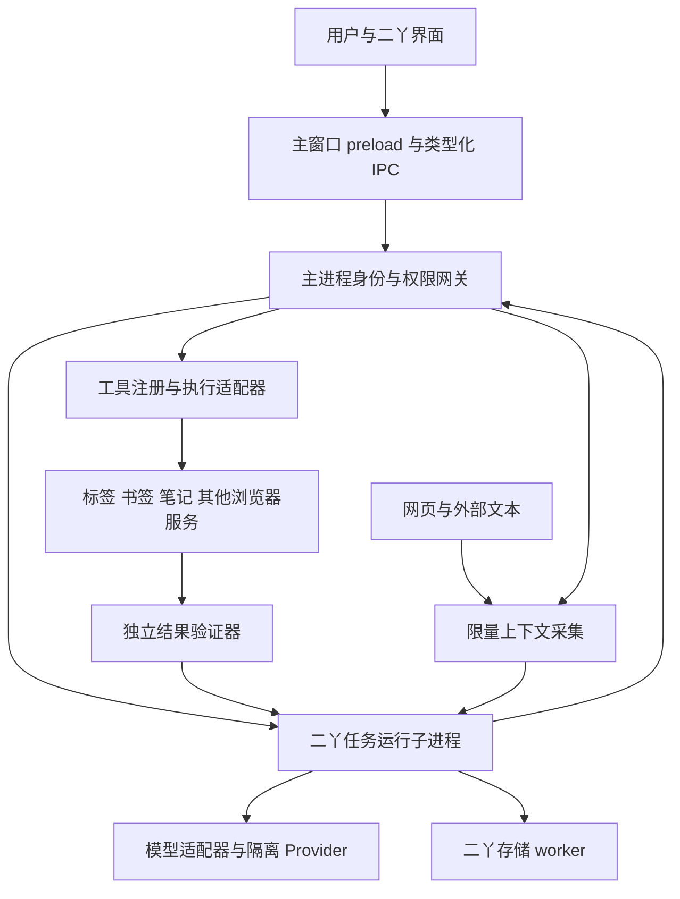

# 06 二丫系统技术架构设计

> 状态：草稿（v0.4 评审草案） · 建立：2026-11-16 · 最近更新：2026-11-16
> 关联：[开发准备总览](./00-二丫AI助手开发准备总览.md) · [仓库文档索引](../文档索引.md)
> 来源：[ChatGPT Pages 原文](https://chatgpt.com/space/page_6127be25df64819184dddd4d8a7c3a4a) · 本地落盘：2026-11-17。正文保留来源稿内容，仅调整标题层级、文档间链接与原型引用；不代表功能已实现或方案已获批准。

版本：v0.4 评审草案，2026-11-16。二丫采用“浏览器提供可靠能力，独立助手负责理解与编排”的增量架构。保留现有 Electron、TypeScript、React、SQLite 体系；以下新增组件是开发建议，尚未实现。关联 ER-001 至 ER-018。

## 现有基础与接入边界

当前源码确认地址栏 AI 按钮和设置页 AI 选项卡仍为占位。2026-10-30 的切割决定将原生 AI 助手与 pi 分离；二丫使用原生 AI 入口，不作为 pi 的新名字，也不恢复已删除的 `summary-agent`、`ai-extension`。

| 已有基础                                | 二丫的使用方式                                                 | 不能据此认定已完成的能力                                    |
| --------------------------------------- | -------------------------------------------------------------- | ----------------------------------------------------------- |
| M11 Orchestrator 与 per-provider 子进程 | 复用生命周期、限流和故障隔离的设计与可用实现，逐项验证取消链路 | 完整 Agent 工具循环、用户授权策略、所有 provider 的真实取消 |
| M12 Provider 合同                       | 增量适配模型调用，按能力清单选择 provider                      | `tools?` 可选接口不保证模型支持或正确调用                   |
| M17 IPC 与 zod 双向校验                 | 新增 `erya.*` 类型化通道和事件                                 | 输入合法不等于调用者有权限                                  |
| M14 `page.extract` 与标签管理           | 在授权检查后采集指定页面，记录来源与版本                       | 所有页面均能抽取、自动拥有跨工作区权限                      |
| 书签与其他原生模块                      | 模块适配器调用领域服务并验证结果                               | 模块存在不等于已有二丫工具适配器                            |
| SQLite、迁移与 safeStorage              | 复用持久化模式和凭据保护机制                                   | SQLite 内容默认已加密                                       |

用户已确认二丫使用 `erya.*`；`ai.*` 原本为二丫前身 AI 助手预留，不归 Pi。当前 `ai.agent.start` 等调用仍通向 Pi 是代码现状，不是保留该命名的理由。`packages/browser-host` 的旧 `AiApi/host.ai`、`@urchin/ai-extension` 注释等也属于盘点范围。二丫开发前实施 CUT-01，逐项清理旧调用与数据路径，禁止仅避开旧设置迁移或长期保留混用接口。

## CUT-01 旧命名与上下游全面切割

这是已纳入范围的 P0 前置任务，关联 ER-009、ER-010、ER-012。目标是二丫上线时只走 `erya.*`，Pi 使用归属明确的自有合同，任何仍需复用的模型基础能力都有独立职责；活跃业务不再依赖旧 `ai.*` 名称。它不是已完成的重构记录。

| 清理层           | 已知线索与盘点范围                                                                                     | 目标与交付                                                                         |
| ---------------- | ------------------------------------------------------------------------------------------------------ | ---------------------------------------------------------------------------------- |
| 用户入口与调用方 | 占位入口、host-impl、browser-host 的 AiApi/host.ai、Pi调用方                                           | 区分二丫、Pi、共享模型能力；移除旧包与死UI引用                                     |
| IPC与事件        | ai.agent.start/abort、ai.chat.start/abort、ai.screenshot、ai.uploadFile、ai.setWorkdir，相关port和事件 | 按实际归属替换调用端、schema、handler、preload白名单与订阅端；不残留只改一端的链路 |
| 模型与后台       | Provider、Orchestrator、任务取消、会话路由、启动/关闭注册                                              | 共用基础层不携带Pi专属状态；失效handler和启动注册移除                              |
| 配置与存储       | settings:ai.%扫描、旧密钥名称、pi/ai.db、StorageLayer.ai与注释                                         | 逐项归属迁移，禁止按前缀把所有旧数据搬给Pi或二丫；流程见07                         |
| 构建与验证       | 包依赖、导出、类型别名、资源清单、脚本、mock、单测/E2E                                                 | 干净构建不需要被删除模块，测试只使用新合同，升级用例单独维护旧样本                 |
| 文档             | README、现行模块/接口/架构文档、代码注释                                                               | 修正把旧命名当现役接口的描述，更新追踪链接；历史变更记录标为历史事实               |

先建立迁移清单，字段为“旧符号或路径、生产者、消费者、真实归属、目标、数据影响、验证、状态”。现已找到的7个点式IPC通道只是起点，实施时需全仓扫描字符串、类型、动态拼接与运行时注册；不能把这张清单当成完整盘点结果。Pi专属通道可映射到 `pi.agent.*` 等候选命名，但具体目标要先检查与现有Pi合同是否冲突。截图、上传等通用功能按实际职责归入相应模块，不能机械地把所有 `ai.*` 替换为 `erya.*`。

代码还存在 GenOffice 供应商的 `ai:*` 冒号协议，与本项目 `ai.*` 点式命名不同。它也要登记来源与调用边界：宿主侧用明确的GenOffice适配层隔离；无法直接修改的外部协议仅在专属适配器内保留，不能成为二丫或Pi的公共授权入口。通用“AI”概念、第三方SDK名称、`ai-provider-contract` 等公共模型职责不是前缀混用本身；保留需在归属清单说明，不能借“公共模块”继续挂载Pi业务或旧助手入口。

执行顺序为盘点与归属确认 → 新合同和迁移规则 → 同批切换生产者与消费者 → 校验数据与行为 → 清理旧注册、别名和死代码 → 静态与运行时验收。发布候选版本不保留旧业务别名或旧前缀写入。确需升级读取旧数据的代码只放独立、带迁移版本和明确旧版本范围的升级模块；逐项列白名单、测试和退休条件，迁移成功后不再日常扫描。历史变更记录保留事实并标注已替代，不篡改过去。

退出条件：项目自有活跃旧业务调用、handler、事件订阅和旧配置写入均为零；扫描剩余项逐项属于有期限的升级兼容、历史证据或已隔离供应商协议；Pi原有功能、普通浏览和二丫新路径全部通过相关回归。未完成CUT-01不得把二丫真实模块接入标为已具备开发前置条件。

## 组件与职责

主进程保有浏览器资源与授权的最终执行权。运行子进程负责规划、模型交互、任务状态机、记忆检索和主动建议，不直接获得任意 Node、Shell 或浏览器数据库访问。单独的存储 worker 持有二丫 SQLite 连接；向量化、压缩和大文本处理均离开主进程事件循环。小规模 MVP 可以保持单个任务运行进程，暂不引入复杂多 Agent 框架。

界面包含会话、任务计划、执行进度、审批、记忆管理和权限设置。用户看到的是步骤、证据、结果及失败原因；不要求展示模型内部推理。AI 悬浮入口、独立任务页和设置页面共享同一状态源。

## 信任边界与数据流

1. 主进程从 Electron sender、窗口与工作区登记中获得真实调用身份；前端传入的 `workspaceId` 只是请求值，必须与权限映射核对。

2. 采集器仅读取明确选中的标签或授权资源。抽取结果附 `sourceId`、资源版本、时间及截断说明。网页文字一律作为资料，不作为授权或系统指令。

3. 发给在线模型前执行数据外发策略，按域名、数据类别与 provider 检查；本地模型失败时不自动把内容转给云端。

4. 模型只能提出结构化工具调用。工具网关检查 schema、权限、工作区、授权期限、预算和当前资源版本，再执行。

5. 写入后调用领域服务回读结果，生成可验证的回执；模型说“成功”不能单独改变任务状态。

6. 仅在用户允许记忆时提取候选内容；权限、凭据、网页命令不作为行为授权记忆。主任务与记忆整理失败相互隔离。

外部 BrowserView 当前没有 preload；保持这一边界，不能为了让二丫读网页就向任意网站暴露 `window.urchin`。新审批通道仅允许可信的主窗口界面调用。

## 工具接入合同

每个工具登记 `toolId`、版本、输入输出 schema、读写资源范围、风险等级、是否可撤销、预计成本、超时、幂等策略、验证器和适配器版本。工具注册表是产品“原生可操控”的能力清单，未注册能力返回不支持，不通过通用脚本绕过。

首批建议 `browser.page.read`、`browser.tabs.listSelected`、`browser.bookmark.create`；笔记创建与验证适配器可作为同阶段下一项。领域方法复用原生模块服务，不让运行子进程模拟 UI 点击操作内部模块。对于外部网站，优先可验证的结构化操作；屏幕坐标操作另行评测后再接入。

L0 只使用用户输入；L1 按范围读取；L2 写入逐次审批；L3 在限时、限工具、限资源及额度内执行低风险操作。首版实现 L0—L2，L3 为后续扩展设计。高风险动作仍逐次确认。授权不是把等级数字交给模型自行解释，而是主进程可执行的策略与能力票据。

## 执行可靠性与恢复

任务状态使用 `draft → planning → awaiting_approval → running → verifying → completed`，并允许 `paused`、`cancelled`、`failed`。只读或已有授权的步骤可跳过审批；写入与核验按步骤循环。部分完成是结果摘要，不新增任务状态；步骤出现 `outcome_unknown` 时任务转为 `paused`，等待回查或用户处理。每一步持有 `taskId`、`stepId`、`idempotencyKey`、`planRevision`、`expectedRevision`。

批准票据绑定规范化参数摘要、资源版本与授权版本；计划修改或资源变化后旧票据失效。撤销权限与派发新步骤在主进程同一串行调度队列处理，执行前再次检查授权；已发生的外部副作用无法靠撤销消除。

浏览器业务库与二丫任务库之间不假装具有跨库事务。写工具需在目标模块的事务中保存操作回执，再更新任务库。若崩溃发生在两者之间，通过操作键回查并恢复状态。目标系统不支持幂等或结果回查时，超时后标记 `outcome_unknown` 并暂停，禁止自动重复提交。暂停/取消阻止后续步骤，并尽力取消正在运行的调用。

## 建议目录与落地顺序

新增建议：`apps/desktop/src/main/erya/` 放权限网关、生命周期和模块适配器；`packages/erya-runtime/` 放状态机、模型适配、记忆策略；`packages/erya-contract/` 放 DTO、工具与事件合同；界面放 `apps/desktop/src/renderer/erya/`。这些路径是拟定方案，需按现有构建边界评审后建立。

真实模块接入前完成CUT-01；A批先验证任务权限、只读与书签写入，NT-01保护笔记并发后完成新建笔记和有限记忆；B批接入速记与日历，C批接入邮箱与跨模块协作。每批按04任务和12门禁验收。GenOffice、DeepSeek Harness、Pi交互仅远期留痕，现有功能回归仍纳入切割验收。

待定：运行时复用现有 M11 到什么程度、额外子进程的内存成本、笔记持久化适配方式，需要技术验证后确定；不因此变更“与 pi 独立”和“主进程控制权限”的边界。

## 速记 日历与邮箱接入架构

本轮增量基线为 `f92816c327cab6978838a860ccddddf26a30e942`。下列二丫适配均待实施；现有领域合同继续由原模块维护，助手不复制日历、邮箱或速记为第二套事实源。ER-013—016由04的NT/CV/CAL/MAIL/LINK任务落实。

| 领域       | 现有基础                                                                                                  | 新建适配与边界                                                                                                                                 |
| ---------- | --------------------------------------------------------------------------------------------------------- | ---------------------------------------------------------------------------------------------------------------------------------------------- |
| 速记笔记本 | NotebookState含notebooks/notes/tasks/stickies/images与视图布局；notebook.state整体保存，渲染层400ms延迟写 | NT-01建立领域命令与单一写协调；新增真实数据/对象revision及回执。UI和二丫共同走协调入口，取消或重放旧延迟保存不得覆盖新内容；不能只给AI加一把锁 |
| 日历M28    | 主进程CalendarService/Repository、M8主库、zod合同；P0/P1已实现，8工具仅预备                               | CAL-01经主进程网关调用同一领域服务，不另建日历Agent或扩大IPC sender白名单。运行进程不直接打开主库                                              |
| 邮箱M25    | account/folder/message接口、缓存、正文协议与SMTP                                                          | MAIL-01范围读取与身份适配；MAIL-02补草稿、回复头与发送回执；不向模型暴露密码/任意附件路径                                                      |
| 来源关联   | 日历已有笔记与任务解析跳转；email/file等类型可保存不等于能解析                                            | LINK-01补邮件稳定引用、访问校验、失效状态和可信导航，不通过模型拼任意URL                                                                       |

现有速记与日历不能凭任务携带workspaceId就视为工作区隔离。INT-00须登记真实存储归属；对档案级资源显式显示全局范围，以profile+领域+资源ID授权。若希望变为工作区专属，必须另有归属迁移；映射不明确的对象拒绝调用。邮箱还要绑定账号、文件夹与邮件身份。任务工作区是任务归属，不自动改变资源归属。

日历上下文按calendarContextSchema选择构造，包含today、IANA时区、日历ID、选中事件及version、时间范围和实际能力；它不是自动注入机制。calendar.changed仅通知回读，不能自动扩大读取范围或触发未授权规划。提醒由现有日历服务负责；二丫主动建议另有授权、频率和预算。

日历创建已具备持久幂等响应，同键不同参数冲突；同键重试返回首次响应，仍需getEvent获取当前状态。更新/软删除使用expectedVersion，不能推断已有通用幂等键。适配器记录操作步骤并在未知结果时对账，无法证明结果则暂停，不能盲重试。两个数据库间仍无跨库原子事务。跨模块产物按步骤持有回执与来源，补偿也走授权。

当前接入范围为速记页（笔记本中的任务清单、笔记、画布，以及本地日历）与邮箱页。A批先完成基础MVP，B批接入速记与日历，C批接入邮箱和跨模块协作；B、C均已纳入当前开发准备。GenOffice、DeepSeek Harness、Pi 与二丫的交互分别记为 FUT-GO、FUT-DSH、FUT-PI，当前只留痕待办，未来另行立项。CUT-01旧 `ai.*` 全面切割及原功能回归仍是近期前置任务，不随远期联动后置。

依据：[日历合同](https://github.com/sgobiorodolfo170-ai/Urchin-Browser/blob/f92816c327cab6978838a860ccddddf26a30e942/docs/contracts/L-智能日历.md)、[ADR-023](https://github.com/sgobiorodolfo170-ai/Urchin-Browser/blob/f92816c327cab6978838a860ccddddf26a30e942/docs/decisions/ADR-023-本地日历与预备工具边界.md)、[速记类型](https://github.com/sgobiorodolfo170-ai/Urchin-Browser/blob/f92816c327cab6978838a860ccddddf26a30e942/apps/desktop/src/renderer/notebook/types.ts)、[速记保存](https://github.com/sgobiorodolfo170-ai/Urchin-Browser/blob/f92816c327cab6978838a860ccddddf26a30e942/apps/desktop/src/renderer/notebook/store.ts)、[邮箱服务](https://github.com/sgobiorodolfo170-ai/Urchin-Browser/blob/f92816c327cab6978838a860ccddddf26a30e942/apps/desktop/src/main/mail/mail-manager.ts)。

## 二丫与原生DevTools的可行性分析

**结论：分层接入可行，自动采集与修改验证需先做限定试验。** 原生F12负责人工诊断；二丫获取主进程裁剪的证据并编排验证。无需解析原生DevTools前端DOM、注入聊天面板、模拟F12点击或重建通用调试器，也不要求升级Electron。窗口和F12行为继续由M15维护。

### 已有基础与证据边界

本轮基线 `f92816c327cab6978838a860ccddddf26a30e942`：`main/devtools/index.ts`仅导出原生快捷键安装及类型；`install-shortcuts.ts`以openDevTools(detach)管理窗口归属和生命周期，没有助手采集API。旧React面板、Manager/CDP采集器、8 RPC与2事件已退出；契约G的旧ai.chat.start、evaluate与Panel API均是历史方案。F12支持普通browser视图的http/https/file，内部页和GenOffice拒绝，不调试浏览器壳兜底。二丫首批自动证据仅选定http/https网页，file后续独立评估授权。

仓库Win11报告记录原生P0已验收，Win10延期，P1未启动；这是已有验收证据，不是本轮二丫集成已实测。ADR-022的早期“迁移执行中”状态与旧规划章节按历史理解，最新实现/需求/最终验收记录决定现状。

| 接入层            | 可行性与推荐方案                                       | 成本与主要缺口                                                  |
| ----------------- | ------------------------------------------------------ | --------------------------------------------------------------- |
| 用户提供错误文本  | 高，复用二丫对话和数据策略                             | 最低；无法证明实时页面状态，不能假装已看F12                     |
| Console文本       | 高，先验证webContents console-message，不强制attach    | 中；仅开始后的事件，文本不等于原生Console全部对象、堆栈和历史   |
| 网络摘要          | 可行，主进程按需CDP窄事件采集                          | 中偏高；时间基准、请求生命周期、过滤、连接所有权及原生共存      |
| DOM/CSS诊断       | 可行，选定节点、有限深度和固定属性的读取               | 高；节点与文档失效、隐私边界、iframe/Shadow范围；没有现成$0联动 |
| 隔离CSS预览与核验 | 有条件可行，安全副本和有限属性差异                     | 高；复制保真、安全清洗、明确视觉判据；不等于线上/源码修复       |
| 二丫跨层诊断      | 有条件可行，仅已授权task/step/provider/workspace元数据 | 最高；需trace关联、时钟与因果证据、真实问题及对照收益           |

### 推荐接入结构

沿用“二丫运行时 → 主进程权限网关 → M15证据服务 → 选定网页webContents”。新证据服务与原生窗口控制器分开：前者管理captureId、预算、脱敏和回收，后者保持F12固定网页及焦点规则。CPU密集脱敏/摘要在worker或运行进程处理，入队前先丢弃禁采字段，主进程不长时间阻塞。

主进程建立可信目标映射profile/workspace/window/tab/webContents/documentRevision；模型不直接指定任意webContentsId。切标签不漂移；网页reload、同tab导航、frame替换或来源范围变化使采集/节点/提案失效，重启必须重检。F12原生窗口可以保持同tab导航，而二丫读取许可不能因此沿用，这是不同生命周期。

console-message可减少连接争用；需要CDP时由受控租约协调器处理二丫与既有剪藏调用。剪藏deep-extract/snapshot-export仍有短时debugger实际调用，不能因旧DevTools采集器删除就认定无其他客户端。新增协调需逐调用方审计；只释放本次持有的租约、监听和对象组，不detach他人会话。占用/被detach时停止相关采集，不自动抢连、不关闭原生F12、不通过全局远程调试端口绕过。

[Electron debugger文档](https://www.electronjs.org/docs/latest/api/debugger)列明detach及事件/命令通路；原生DevTools启用可能终止debugger会话。项目早期探针也曾观察到共存成功，所以不能断言“必然抢占”或“必然可共存”。DT-01在锁定的Electron 43.8.8 / Chromium 150.0.7871.250及目标平台验证打开顺序、剪藏并发和断开；兼容结论随版本记录，失效时回退DT-00和原生人工调试。

### 投入与退出条件

DevTools接入按易到难分为DT-00手动报错解释、DT-01受控证据原型、DT-02按需Console、DT-03网络元数据、DT-04选定DOM/CSS、DT-05隔离样式预览与前后核验、DT-06二丫/Provider/工作区关联诊断。DT-00可在A批基础闭环后增加；自动采集作为C批后的D批限定试验，先做DT-01/02和DT-QA，后续能力在收益与安全门槛通过后逐项启动，不阻塞原A/B/C批。

每个自动证据工具仅在能力探测、隐私过滤、限额、取消与F12回归通过后登记。DT-01/02最小原型与对照沿用项目最多5+5有效工作日闸门；没有真实任务或无法证明收益则停止扩大。后续网络/DOM/预览/跨层能力是条件候选，不把技术可行为由提前承诺完整平台。任意JS执行、原始CDP、清存储、重放请求、调试任意应用进程均不在该能力授权内。

依据：[ADR-022](https://github.com/sgobiorodolfo170-ai/Urchin-Browser/blob/f92816c327cab6978838a860ccddddf26a30e942/docs/decisions/ADR-022-原生DevTools与专属调试增强.md)、[现行需求](https://github.com/sgobiorodolfo170-ai/Urchin-Browser/blob/f92816c327cab6978838a860ccddddf26a30e942/docs/开发者工具需求文档.md)、[开发规划](https://github.com/sgobiorodolfo170-ai/Urchin-Browser/blob/f92816c327cab6978838a860ccddddf26a30e942/docs/开发者工具开发规划.md)、[Win11验收](https://github.com/sgobiorodolfo170-ai/Urchin-Browser/blob/f92816c327cab6978838a860ccddddf26a30e942/docs/开发者工具P0验收-Win11-2026-11-16.md)、[原生控制器](https://github.com/sgobiorodolfo170-ai/Urchin-Browser/blob/f92816c327cab6978838a860ccddddf26a30e942/apps/desktop/src/main/devtools/install-shortcuts.ts)、[剪藏调用](https://github.com/sgobiorodolfo170-ai/Urchin-Browser/blob/f92816c327cab6978838a860ccddddf26a30e942/apps/desktop/src/main/clipper/deep-extract.ts)、[Electron console-message](https://www.electronjs.org/docs/latest/api/web-contents#event-console-message)。

## 源码依据

检查基线：`7f9f59af29c641ae5900849ee685dc3570a443b6`。M12 当前消息类型缺少完整工具结果关联与 call id；需要新增 Agent DTO 或适配层，不能仅接一个模型就宣称闭环完成。

- [AI 助手与 pi 切割整改报告](https://github.com/sgobiorodolfo170-ai/Urchin-Browser/blob/7f9f59af29c641ae5900849ee685dc3570a443b6/docs/AI助手与pi切割整改报告.md)

- [IPC 调用包装器](https://github.com/sgobiorodolfo170-ai/Urchin-Browser/blob/7f9f59af29c641ae5900849ee685dc3570a443b6/packages/ipc-contract/src/server.ts#L69)

- [模型消息合同](https://github.com/sgobiorodolfo170-ai/Urchin-Browser/blob/7f9f59af29c641ae5900849ee685dc3570a443b6/packages/ai-provider-contract/src/messages.ts)

- [设置与历史迁移](https://github.com/sgobiorodolfo170-ai/Urchin-Browser/blob/7f9f59af29c641ae5900849ee685dc3570a443b6/apps/desktop/src/main/settings/settings-manager.ts#L233)
