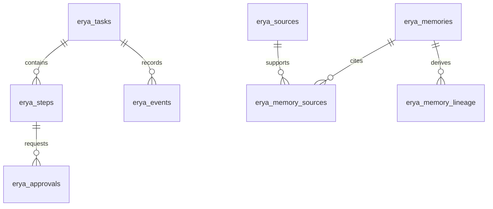

# 07 二丫数据库设计文档

> 状态：草稿（v0.5 评审草案） · 建立：2026-11-16 · 最近更新：2026-11-17
> 关联：[开发准备总览](./00-二丫AI助手开发准备总览.md) · [仓库文档索引](../文档索引.md)
> 来源：[ChatGPT Pages 原文](https://chatgpt.com/space/page_803ff17888f081919140c61a2c7e16d5) · 本地落盘：2026-11-17。初次落盘保留来源稿；2026-11-17本地增量纳入dsh-pet借鉴要求，来源与取舍见00。以下仍为待实施方案，不代表功能已实现；Pages来源稿未同步本轮增量。

版本：v0.5 评审草案，2026-11-17。数据库需要保存任务进度、授权依据、执行回执与有限记忆，使二丫能解释结果、恢复中断并真正遗忘。以下均为新增设计，现有浏览器和 pi 数据不自动导入。关联 ER-003、004、007、008、009、012、013、014、015、016、017、018。

## 存储位置与管理方式

现有 `StorageLayer` 把浏览器主库放在 `<dataDir>/urchin.db`，pi 会话库放在固定 `<userData>/pi/ai.db`；二者采用 SQLite WAL。建议二丫新增 `<dataDir>/erya/erya.db`，与 pi 独立，随浏览器用户数据目录管理。由单独存储 worker 持有连接，复用现有按版本、事务迁移模式。

模型密钥不写入记忆、任务或普通设置表；使用独立命名空间的 SecretStore 与 safeStorage。现有敏感设置集合仅含 `pi.apiKey`，新增二丫密钥需要专门接入，二丫凭据入口和存储标识使用 `erya.*` 自有命名，不能把旧 `ai.apiKey` 复制成普通设置或默认继承到二丫。数据库加密需另行选型；safeStorage 保护密钥不代表整个 SQLite 文件已加密。

单机 MVP 按用户档案隔离数据库，表内仍保存 `profile_id`、`workspace_id` 以支持权限校验和防止未来迁移混淆。用户明确选择的全局偏好使用 `scope=profile`，不得把缺失工作区视为全局。

## 公共字段约定

业务 ID 使用不可猜测的字符串 ID；时间使用 UTC 毫秒整数，显示时转换时区。JSON 字段写入前经 zod 校验并带版本，大小受限；不存二进制大文件或任意执行代码。`revision` 从 1 递增，更新要求匹配旧版本。SQL 使用 snake_case，IPC 使用 camelCase。

## 实体与字段字典

下表列出最低必要字段。`id` 均为主键；除注明可空的引用外，必填字段使用 `NOT NULL`。所有用户数据实体携带档案与作用域，关系通过复合外键或服务层双重校验保证不会跨工作区引用。

| 表                         | 主要字段与含义                                                                                                                                                               | 关键约束                                                    |
| -------------------------- | ---------------------------------------------------------------------------------------------------------------------------------------------------------------------------- | ----------------------------------------------------------- |
| `erya_tasks`               | id、profile_id、workspace_id、goal、state、plan_revision、revision、budget_json、outcome_code、idempotency_key、request_hash、created_at、updated_at                         | state 限定九态；预算非负；同作用域幂等键唯一                |
| `erya_steps`               | id、task_id、ordinal、tool_id、tool_version、args_json、args_hash、state、expected_revision、idempotency_key、receipt_json                                                   | 同任务 ordinal 唯一；参数脱敏；task_id 外键                 |
| `erya_approvals`           | id、task_id、step_id、actor_id、workspace_id、args_hash、plan_revision、resource_revision、grant_revision、decision、expires_at、decided_at、consumed_at、revision           | 审批由可信 UI 写；有效期与消费状态检查                      |
| `erya_grants`              | id、profile_id、workspace_id、level、tools_json、resources_json、limits_json、expires_at、revoked_at、revision                                                               | level 为 L0–L3；明确资源范围；禁止空值代表无限              |
| `erya_events`              | id、task_id、sequence、type、payload_json、created_at                                                                                                                        | `(task_id,sequence)` 唯一；持久事件限量脱敏                 |
| `erya_sources`             | id、profile_id、workspace_id、resource_type、resource_id、resource_revision、captured_at、content_hash、excerpt、expires_at、deleted_at                                      | 摘录可空；不保存 Cookie、口令                               |
| `erya_memories`            | id、profile_id、workspace_id、scope、kind、content、status、sensitivity、confidence、content_version、supersedes_id、expires_at、last_used_at、pinned、byte_size、deleted_at | status 为 candidate/active/archived/deleted；confidence 0–1 |
| `erya_memory_sources`      | memory_id、source_id、relation                                                                                                                                               | 复合主键；来源与派生关系可追溯                              |
| `erya_memory_lineage`      | parent_id、child_id、transform_version                                                                                                                                       | 记录压缩、合并、纠正的依赖；禁止自环与循环                  |
| `erya_memory_usage`        | profile_id、item_count、content_bytes、index_bytes、pinned_bytes、reserved_bytes、updated_at                                                                                 | 每档案一行；容量预留与写入同事务；物理文件另行测量          |
| `erya_deletion_tombstones` | id、profile_id、object_type、object_id、deleted_at、scope_hash                                                                                                               | 仅标识与时间，不保留已删正文                                |
| `erya_settings`            | profile_id、key、value_json、revision                                                                                                                                        | 复合主键；只放非敏感设置                                    |
| `erya_evaluations`         | id、runtime_version、prompt_version、model_ref、tool_versions_json、dataset_version、metrics_json、created_at                                                                | 保存评测配置与汇总，不默认保留私人任务文本                  |

任务 state 限定为 `draft/planning/awaiting_approval/running/verifying/paused/completed/cancelled/failed`；步骤 state 为 `prepared/running/verifying/succeeded/failed/cancelled/outcome_unknown`。部分完成写入 `outcome_code` 与结果摘要，步骤结果未知使任务暂停。审批和步骤通过所属任务继承档案与工作区，校验时必须联查；跨作用域引用拒绝写入。

会话文本可用新增 `erya_conversations` 与 `erya_messages` 保存：消息关联会话、task_id 可空，并有保留期限；不能复用 pi `conversation_messages`。MVP 如果只保存任务输入与结果，可暂不建独立会话表，但 UI 必须明确关闭窗口后的记录范围。

## 关系与索引

建议索引：任务 `(profile_id,workspace_id,state,updated_at)`；步骤 `(task_id,ordinal)`；授权 `(profile_id,workspace_id,revoked_at,expires_at)`；记忆 `(profile_id,workspace_id,status,expires_at)`；来源 `(profile_id,workspace_id,resource_id)`；谱系 `parent_id` 与 `child_id` 双向索引。任务幂等键增加 `(profile_id,workspace_id,idempotency_key)` 唯一约束；如果幂等键放在独立请求表，同样保存参数摘要与原始响应引用。

步骤另设 `(task_id,idempotency_key)` 唯一约束，并记录参数摘要和工具版本；同键不同请求拒绝。目标模块另保留与业务变更同事务的操作回执，不能用二丫库的唯一键替代该保证。任务创建的 request_hash 与步骤参数摘要各自维护。

每次连接显式开启 `foreign_keys=ON` 并验证生效；现有迁移代码的 REFERENCES 声明不能替代连接级设置。跨工作区外键用带作用域的复合键，或在单事务中校验双方作用域。先按元数据与全文检索实现记忆查找；向量索引后续按评测需要加入，索引必须能从有效记忆重建。

## 写入与并发规则

任务变更采用乐观锁：`UPDATE ... WHERE id=? AND revision=?`，影响行数为 0 返回版本冲突。审批只能被指定步骤消费一次；消费与任务状态迁移同事务，授权撤销需在执行网关再检查。

记忆写入先计算条数、内容和索引预计占用，事务中预留额度，再写记录与来源关系；失败释放预留。容量不足先整理可过期、未固定的内容，不能静默删除用户固定记忆；仍不足则停止新增并提示选择。长期内容额度、含数据库和 WAL 的活动存储物理预算、备份保留预算、每次发给模型的 token 预算、任务事件保留期限分别控制。压缩时为原文与新摘要共存预留空间；不能只计算摘要大小就假定磁盘已经腾空。

浏览器主库与二丫库不进行长时间跨库锁定。书签工具的幂等回执须与目标书签写入同一模块事务保存；二丫侧记录回执引用并在崩溃后对账。仅在二丫库写一个“已执行”标记不能保证外部动作恰好一次。

## 遗忘 压缩与删除

候选记忆通过来源、敏感性和用户设置检查后转为 active。检索只返回当前授权可见、未过期、未删除的 active 记录；使用频率不能把推测变成事实。纠正创建新版本并关联 `supersedes_id`，旧版本不再进入默认检索。

压缩保留来源与谱系，压缩后质量检查通过才替换索引。用户删除一条记忆时，立即设置不可检索标记，再删除内容、缓存及向量，沿谱系找到依赖摘要：删除或根据剩余有效来源重新计算。恢复时须合并备份之外、比备份更新的删除墓碑台账；仅恢复旧快照内的墓碑不能防止复活。若最新台账丢失，恢复结果先隔离并告知用户，不能直接重新开放检索。删除来源网页不等于自动删除用户自己写的笔记；界面明确显示删除范围。

逻辑删除不等于磁盘已无残留。后台处理 WAL checkpoint、空闲页整理和备份到期清除；不承诺 SSD 上可验证的物理擦除。隐私会话默认只用内存，结束时释放上下文且不写长期记忆。

## 在途记忆任务与迟到写回保护（v0.5）

上游删除代数是本节参考，证据见00；二丫同时保留持久墓碑、来源谱系和独立许可校验。下列字段/表尚未实现，纳入MEM-GUARD迁移设计，不能只做进程内Map。

| 拟增结构           | 字段或约束                                                                                                                 | 用途                                                                                                                 |
| ------------------ | -------------------------------------------------------------------------------------------------------------------------- | -------------------------------------------------------------------------------------------------------------------- |
| erya_memory_scopes | id主键、profile_id、scope、workspace_id、mutation_epoch                                                                    | 以profile_id+规范化作用域键唯一；显式约束profile范围workspace为空、workspace范围非空；epoch单调递增，scope_ref引用id |
| erya_memory_jobs   | id、scope_ref、kind、source_refs_json、epoch_at_start、grant_revision、policy_revision、state、idempotency_key、created_at | 记录提取/压缩/向量化候选；来源携带ID及contentVersion，队列内容最小化，不保存完整私密请求                             |

scope_ref引用erya_memory_scopes.id，并联查档案及作用域；记忆任务的幂等键在该作用域内唯一。grant_revision绑定本次记忆读/写及必要外发许可，policy_revision绑定数据策略版本，均与当前可信策略记录比较，不能只信任任务携带的旧数字。后台任务state拟定queued/running/committed/discarded/failed；终态及必要错误码保留到清理期限，epoch从1开始且不得因重启或清空记忆重置。

删除或纠正记忆时，在同一存储事务内更新墓碑/内容版本、推进作用域mutation_epoch、标记相关排队任务失效并移除检索可见性。撤销记忆许可推进对应grant/policy版本并使相关任务失效。后台任务开始时取epoch及版本，提交时在同一事务中重新校验当前epoch、来源active状态/版本、谱系、许可与配额；任何不匹配均丢弃结果，不能靠旧快照重新创建记忆。作用域epoch变化可保守作废该作用域的旧任务；重算须取得新快照且仍有许可，不自动复制失效内容重排队。

模型/嵌入网络调用在事务外执行；持锁只做短校验和提交，避免阻塞用户删除。删除、纠正、撤权应尽力abort在途调用，但正确性依靠提交检查，不依靠对端接受abort。生成已经结束或返回成功仍不代表可写回。运行时缓存与检索证据也检查来源版本/epoch，不能在删除后继续发送尚未外发的旧证据。

重启后恢复任务先重新检查身份、来源、许可、epoch及墓碑；不可恢复的生成直接作废，未知外部提交按回执对账。幂等键不使用时间戳单独标识一轮。异步任务错误单列状态和可清理记录，不改写已完成的书签/笔记任务；错误日志不含正文。

第三方记忆服务未来接入时须有可验证的写入、删除/纠正和对账协议。已派发的远端写入可能晚于删除完成，本地epoch无法单独阻止对端落盘；应登记在途操作、关闭召回、等待或对账并清除迟到内容，确认后才标记远端清理完成。无法保证者不得接入敏感长期记忆。恢复本地备份仍合并独立最新墓碑；上游局部代数不能替代这一恢复规则。

## 迁移 备份与恢复

### CUT-01 历史数据归属与清理

`ai.*` 不归Pi；当前旧数据的去向必须依据实际用途、产生版本、调用方及存储位置判断。用户接受 `erya.*` 不代表授权丢弃Pi会话、覆盖配置或把所有旧助手记录当作二丫记忆。

先盘点旧设置、凭据文件、数据库、会话、缓存及索引。确认属于Pi的存量配置继续归Pi，现有Pi值优先；二丫默认建立独立空存储，旧助手数据只有经明确的导入规则和用户选择才能进入。未知、冲突或损坏项保留在隔离区并报告，不能按前缀猜归属、静默删除或写入新助手。

移除主进程启动中的 `settings:ai.%` 通配搬运，替换为独立版本迁移及具体旧键白名单；成功后记录迁移版本，不再每次启动扫描。失败不能写“成功”标记，重启可安全重试且不覆盖已有有效配置。密钥保持加密读取与重存，日志不输出值。

现有 `<userData>/pi/ai.db`、StorageLayer.ai及宿主合同里的旧归属命名纳入整治，建议目标为 `<userData>/pi/pi.db` 与Pi专属访问器，最终路径在迁移清单中锁定。迁移暂停相关服务，生成包含WAL状态的一致性备份，校验表、行数、关键关联和抽样内容，再原子切换指针。磁盘不足、文件锁或中断时保留可恢复的旧副本，不能只重命名单个主文件、遗漏WAL/SHM。旧新库同时存在时禁止双写和自动覆盖。

旧密钥、数据副本与备份按迁移成功、恢复验证和用户数据保留策略退出；必须公布清理时点。回滚只恢复受支持的整套版本/路径映射，不重开活跃旧IPC或将erya数据重写为ai数据。最新删除台账继续生效。

新库建立独立 `schema_migrations`，按递增版本事务迁移。启动先检查最低兼容版本；迁移失败保留旧库并禁用二丫写入，不阻断浏览器基本浏览。升级采用先增字段再迁移数据的兼容策略，不随应用降级执行破坏性反向 SQL。

备份用 SQLite 一致性快照或关闭连接后的完整复制，不直接只拷贝 WAL 模式下的主文件。备份包含数据库、索引版本、墓碑和 manifest；凭据单独按用户选择处理，不输出明文。换数据目录前暂停任务、关闭连接、复制并校验后切换指针，失败回退原目录。恢复先校验完整性、版本、作用域与删除墓碑，重建派生索引，再开放检索。

待验证：记忆数量增长时的检索延迟、压缩收益、worker 内存占用和备份耗时。它们是后续测试项目，不是本草案的已测指标。

## 模块数据与来源引用设计

ER-013—016沿用各模块的事实源：速记当前存于notebook.state；日历已在urchin.db，迁移5包括日历/事件/幂等/审计，迁移6包括重复例外/提醒投递/恢复快照；邮箱保留原账号与缓存。二丫库仅保存任务回执、必要来源和经授权记忆，不默认复制邮件正文、画布文件或全部日程。

| 数据对象     | 拟新增或复用字段                                                                                    | 约束                                                                                                                   |
| ------------ | --------------------------------------------------------------------------------------------------- | ---------------------------------------------------------------------------------------------------------------------- |
| 模块资源引用 | domain、profileId、scopeKind、workspaceId可空、resourceId、revision、capturedAt、contentHash        | scopeKind区分profile/workspace；可空workspace仅在显式profile范围合法；不能以缺失表示全局授权                           |
| 速记对象     | notebookId、对象ID、新dataRevision/objectRevision；操作键与参数摘要回执                             | 现有state.version是格式版本1，不是并发锁；updatedAt也不能单独保证CAS。领域写与回执持久化须原子或具备可恢复日志         |
| 日历引用     | calendarId、eventId、version；重复实例seriesId/occurrenceDate                                       | 时间存储遵循原合同，不套用二丫UTC毫秒规范覆盖日历：定时为带offset ISO+IANA，全天为日期和排他结束日                     |
| 邮件引用     | 不透明mailRefId映射账号/文件夹/UID/UIDVALIDITY及可用的原Message-ID                                  | 当前合同缺UIDVALIDITY；补齐并校验后才能持久可靠关联。Message-ID辅助核对，不能单独当唯一身份；移动后不能仅按UID猜同一封 |
| 本地邮箱草稿 | draftId、accountId、replySourceRef、to/cc/bcc、subject、body、attachmentRefs、revision、updatedAt   | MAIL-02拟建，非现有已实现表；属于邮箱领域，需可回读并交接撰写框；IMAP服务端草稿同步另评估                              |
| 发送尝试     | operationId、draftRevision、argsHash、approvedAt、state、serverMessageId、submittedAt、reconciledAt | pending/submitted/accepted/failed/unknown；不自动把accepted当delivered；私密正文按保留策略单独保护                     |
| 跨模块来源   | sourceRef、targetRef、stepId、relationType、resolutionStatus                                        | 可解析/无权限/失效/待解析可区分；跨库引用由服务校验，不虚设跨库外键                                                    |

邮件删除或任务记忆清理不能静默删除用户独立保存的笔记/日程；记忆删除需清除其派生摘要与索引，用户产物按单独操作管理。源失效保留不含正文的必要引用状态，不回退到相同UID的别封邮件。画布文件仅引用，不自动复制到二丫库。

NT-01先确定单一写入口和崩溃恢复方案，再决定是否拆表迁移，不能为接入默认重建整个笔记系统。MAIL-01/02、LINK-01的结构变更均需版本迁移、备份恢复和旧数据身份失效用例。日历备份恢复是整库替换式操作，初期不向二丫暴露；不能当作单次事件撤销。

## 调试证据的存储与生命周期

ER-017/018初期复用erya_sources、steps/events及回执结构，不因诊断默认建完整日志仓库。原生F12自身历史不自动导入；采集缓冲与原始文本默认只在内存中按条数和字节双限保存，停止后仅在本次任务有效期内供分析，导航/撤权时移除未批准使用的内容。

拟定EvidenceRef字段：evidenceId、captureId、sourceKind、profileId/workspaceId、targetRef、documentRevision、capturedAt、monotonicOffset、coverageStart/End、truncated/droppedCount、redactionVersion、contentHash及expiresAt。身份与时间由主进程补齐；UTC用于跨记录展示，同一单调时钟差用于网络耗时，不混用wallTime与timestamp。CDP requestId/sessionId、DOM node引用只在其采集/文档作用域内有效，不当作跨导航永久ID。

诊断报告仅在用户选择保存任务记录时持久化必要脱敏摘录与引用；默认不存请求头/体、Cookie、存储值、完整DOM、截图或堆快照。长期记忆另行确认，不自动记住站点报错或邮件/页面秘密。删除同时覆盖证据摘录、缓存和派生诊断摘要；导出报告单独预览脱敏范围。

隔离预览保存短期previewId、sourceDocumentRevision、允许的CSS差异、视口、验证判据、结果和过期时间；禁脚本/禁外联、不带登录态。副本清理不改变原网页；用户关页或源版本变更后旧previewId不可再操作。DT-06只存真实taskId/stepId/providerRequestId关联和已核实时间顺序，不凭时间相近补造trace。

## 源码依据

基线 `7f9f59af29c641ae5900849ee685dc3570a443b6`。当前迁移表包括主库书签等及 pi 会话表，尚无上述 `erya_*` 表。

- [现有存储层](https://github.com/sgobiorodolfo170-ai/Urchin-Browser/blob/7f9f59af29c641ae5900849ee685dc3570a443b6/apps/desktop/src/main/storage/storage-layer.ts)

- [现有数据库迁移](https://github.com/sgobiorodolfo170-ai/Urchin-Browser/blob/7f9f59af29c641ae5900849ee685dc3570a443b6/apps/desktop/src/main/storage/migrations.ts)

- [凭据存储](https://github.com/sgobiorodolfo170-ai/Urchin-Browser/blob/7f9f59af29c641ae5900849ee685dc3570a443b6/apps/desktop/src/main/storage/secret-store.ts)

- [敏感设置及历史迁移](https://github.com/sgobiorodolfo170-ai/Urchin-Browser/blob/7f9f59af29c641ae5900849ee685dc3570a443b6/apps/desktop/src/main/settings/settings-manager.ts)
