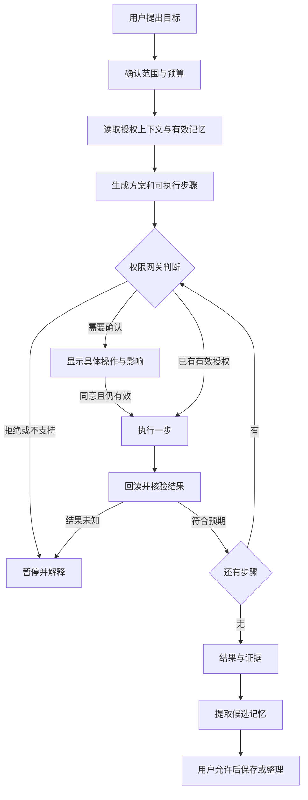

# 09 二丫 Agent 工作流设计

> 状态：草稿（v0.4 评审草案） · 建立：2026-11-16 · 最近更新：2026-11-16
> 关联：[开发准备总览](./00-二丫AI助手开发准备总览.md) · [仓库文档索引](../文档索引.md)
> 来源：[ChatGPT Pages 原文](https://chatgpt.com/space/page_54bf59b79d3c8191ac525684fd9f3fac) · 本地落盘：2026-11-17。正文保留来源稿内容，仅调整标题层级、文档间链接与原型引用；不代表功能已实现或方案已获批准。

二丫的工作流把“理解目标、作出建议、执行动作、检查结果、整理记忆”连成一个可暂停、可追溯的过程。模型负责提出方案，程序负责权限与预算，工具负责实际操作，验证器负责确认结果。长期记忆辅助理解用户，不赋予执行权限。

版本：v0.4 评审草案，2026-11-16。以下是拟开发规则。关联 ER-001 至 ER-018；任务状态、字段与06架构、07数据库、10接口保持一致。

## 一次任务的完整路径

理解目标时只追问影响执行的缺口。例如“把资料整理好”需要明确目的地；单纯比较方案可先给建议。来源不足时说明缺失内容，不用猜测补齐事实。默认读取当前任务明确选择的页面，检索记忆前先限定档案、工作区和数据类别。

计划中的每一步包含工具版本、目标资源、规范化参数、预期结果、依赖、风险、超时、验证方式及可撤销性。建议以内部原生模块工具为先，不用模型生成任意 JavaScript 来替代可靠接口。未接入的功能返回“不支持”，并给出用户可手动完成的步骤。

## 状态与停止条件

| 任务状态            | 进入条件                           | 下一步                         |
| ------------------- | ---------------------------------- | ------------------------------ |
| `draft`             | 收到目标，尚未开始                 | 用户开始后进入 planning        |
| `planning`          | 收集范围内资料并形成计划           | 进入待确认或运行               |
| `awaiting_approval` | 有具体步骤等待用户决定             | 同意后复核；拒绝后暂停或取消   |
| `running`           | 正在执行一个步骤                   | 进入 verifying；故障按类型处理 |
| `verifying`         | 检查资源状态及回执                 | 下一步运行或完成               |
| `paused`            | 授权、预算、冲突或未知结果阻止继续 | 解释原因，由用户选择恢复或取消 |
| `completed`         | 所有必要步骤经核验完成             | 返回结果，独立处理记忆候选     |
| `cancelled`         | 用户取消或明确结束                 | 不派发新步骤，保留已有结果摘要 |
| `failed`            | 必要步骤确定失败且无法继续         | 返回失败依据与可行恢复办法     |

步骤另有 `prepared/running/verifying/succeeded/failed/cancelled/outcome_unknown` 状态。`outcome_unknown` 表示已提交的写入是否生效无法确认，任务进入 paused；“部分完成”写在结果摘要中，不增加一个互相冲突的任务状态。

建议初始执行预算为最多10个工具步骤、连续两次同类错误即暂停、同一只读请求最多重试两次；这些是试验参数，不是对所有任务的硬编码。任务还设金额、输入输出 token 和最长运行时间上限。等待人工确认不消耗执行时间预算，但授权按真实时间到期。模型调用前预留最大费用，返回后按实际 usage结算；无法准确计费时采用保守预留。

取消立即阻止后续调度并向运行中的模型与工具发送取消信号。适配器必须明确“已取消”还是“仅请求取消”；已经发送的邮件等副作用不能假装撤回。授权撤销、暂停与新步骤派发由同一执行网关处理，避免检查后又被并发请求越过。

## 准确执行与恢复

审批绑定 `taskId/stepId/argsHash/planRevision/resourceRevision/grantRevision/expiresAt`。模型修改内容、资源被用户编辑或授权更新时，旧审批不能继续使用。执行前重新读取必要的前置状态，不能只信任规划时的快照。

每次写操作有稳定 `idempotencyKey`。书签等本地模块在自身事务内写业务结果和操作回执；二丫任务库随后记录回执。两库之间崩溃时以操作键回查，不能依靠“任务显示未完成”直接再写一次。外部系统不支持去重或回查时，超时进入 outcome_unknown，只允许核实，不自动重试。

验证器尽量使用确定性条件。例如书签的URL、文件夹和标题与确认内容一致；笔记回读存在、内容版本匹配且来源链接齐全。涉及语义判断时可加独立模型或人工评审，但不以执行模型的自评替代状态检查。补偿动作也是写操作，仍需对应授权；“撤销”只在适配器声明并通过验证时提供。

## 决策辅助与主动建议

决策输出固定包含目标、候选选项、可核对的证据、取舍、推荐理由、不确定项和下一步。把网页事实、用户偏好和二丫推断分开；不能因为用户喜欢某方案就隐藏反例。来源记录采集时间及版本，过时价格或缺失条件要在推荐旁说明。

首版由用户主动发起比较与规划。后续主动建议在用户开启后由具体事件触发，例如重复收藏、同一任务积累多份资料或偏好过期。每个规则包含触发条件、允许的数据范围、冷却时间和每日提醒上限；建议初始上限每天3条，同一事件24小时内不重复。用户拒绝或关闭后立即尊重，安静时段不弹出打断式窗口。

主动发现只产生建议，不自动增加读权限。L3有限自主也只能在事先限定的工具、对象、期限和额度内执行低风险动作。发信、付款、不可恢复删除、凭据与权限变更保留逐次确认。

## 记忆的类型与生命周期

| 类型     | 用途                       | 保存规则                                       |
| -------- | -------------------------- | ---------------------------------------------- |
| 工作记忆 | 当前目标、步骤、少量上下文 | 任务结束后按会话保留策略清理；不自动变长期记忆 |
| 情景记忆 | 已完成任务的简要经验       | 优先保存结果与方法，避免整页原文和完整活动轨迹 |
| 语义记忆 | 用户明确偏好、稳定事实     | 保留来源、作用域、有效期，支持纠正与固定       |
| 流程记忆 | 经评测的可复用步骤模板     | 带版本和适用条件，不含永久授权或可执行任意代码 |

生命周期为 `candidate → active → archived/deleted`。首版长期候选由用户确认后转为active；自动提取可形成候选但不能越过保存策略。推断出来的偏好标为推断，反复召回不会自动提升为事实。出现冲突时保留双方来源，优先采用用户最新明确纠正，并使旧版本退出默认检索。

每条记忆记录内容、类型、来源、所属工作区、敏感级别、形成方式、内容版本、最近使用时间、到期时间和固定状态。`confidence` 是系统内部依据质量标记，未经校准不能显示为“事实正确概率”。密码、API密钥、Cookie、权限票据和网页中的行为指令不进入长期记忆。

## 脑容量 遗忘与压缩

容量分成三件事：可保存多少内容、磁盘实际占用多少空间、每次模型能看多少记忆。建议技术验证先用1000条且内容不超过10MiB、活动存储预算50MiB、单次检索不超过2000 tokens的试验档；最终默认值以设备和评测结果确定，界面演示数值不作为正式配置。条数与字节上限同时生效，固定条目也计入容量。

活动存储预算覆盖正文、来源摘录、索引、事件和WAL；备份另设保留数量与磁盘上限。压缩要预留新旧副本并存空间。到达阈值先清理到期与失效数据，再去重、压缩未固定内容；仍不足时暂停新增，说明是哪类数据占满，而不是继续无限写入。

对未固定、可清理候选，可试用保留分数：`0.35×任务相关度 + 0.25×来源可靠度 + 0.20×近期使用度 + 0.20×用户明确价值`，各项归一到0至1。这只是可评测的排序启发式，不是人脑规律。敏感性、用户删除和到期规则优先于分数；使用次数不能抵消明确过期。

压缩先建立可逆候选：去重并合并同一事实，保留否定词、数值单位、适用条件、不确定性、更新时间和来源关系。对照原记录检查这些字段，冲突无法消解时保留冲突，不拼成虚假结论。通过验证才替换检索索引；失败保留原条目或暂停整理。原始内容按已公布期限释放，不能为“可逆”永久保留所有历史。

## 真正遗忘与受控升级

删除立即让记录退出检索，再删除正文、向量、缓存和依赖它的摘要；混合来源摘要需删除或按剩余来源重算。谱系关系记录父子依赖，防止删了原文却仍从压缩记忆返回同一事实。备份残留按保留期清除；恢复前对照独立于该旧备份的最新删除台账。若只有旧备份而没有最新台账，不能保证防复活，应暂停恢复长期记忆并让用户确认导入范围。

无痕任务仅在内存处理，不写长期记忆、正文日志或持久恢复快照；崩溃后不能恢复是预期代价。在线模型处理仍需要外发许可，无痕不等于内容未离开设备。

能力升级记录运行时、提示词、模型、工具、记忆算法和数据集版本。先跑固定回归和安全反例，再小范围启用；质量下降或预算异常即回退。偏好学习可以改变推荐排序，不能改变安全策略。流程模板、工具代码与模型版本升级需经过开发发布流程，禁止把“自我迭代”解释成运行中自行改程序或授予新权限。

## 速记 日历与邮箱工作流

| 流程       | 执行顺序                                                  | 核验与停止                                                              |
| ---------- | --------------------------------------------------------- | ----------------------------------------------------------------------- |
| 笔记与任务 | 选笔记本/对象→读取→形成差异→审批→按版本写入               | 回读ID/文本/完成状态；用户并发改动使旧审批失效；不整份覆盖状态          |
| 画布       | 选便签→读取文字→预览内容及可选布局→审批→逐对象写入        | 回读坐标/尺寸/内容，选区外不变；部分失败只恢复未完成对象                |
| 日历       | 解析绝对日期/时区→选日历范围→查空闲/冲突→选方案→审批→写入 | 写前再查冲突；更新/删除检查version及重复scope；创建重试后也getEvent回读 |
| 邮件       | 选账号与邮件→核身份读取→摘要/草案→审批存草稿→回读         | 发送另审批最终内容；进入提交后未知不自动重发；SMTP接受不称送达          |
| 邮件转产物 | 解析来源→预览笔记/任务/日程→分步审批执行→各自回读         | 记录产物ID，后续失败不重建已成项；补偿也需权限                          |

跨模块步骤依赖显式保存，例如源邮件读取→拟任务→用户确认；不能把邮件中的命令当授权。每步重检资源范围、版本、审批和预算，任务暂停恢复仍重检。全局领域对象使用INT-00真实范围映射，不因当前工作区推定隔离。

主动整理任务或提醒另行开启，不默认扫描所有邮件和笔记；日历提醒不等于二丫拥有持续后台巡查权。记忆候选只在完成后独立征求保存许可，跨模块来源保留不自动变成长期偏好。GenOffice/Harness/Pi联动仅远期待办。

## DevTools诊断与验证流程

ER-017/018：用户目标 → 选择手动文本或明确网页 → 判断证据缺口 → 选择最小采集类型与窗口 → 检查读取/外发授权和预算 → 有界采集 → 用户重现 → 停止与脱敏 → 证据引用 → 候选原因和待验证步骤。没有数据时返回“本次未采到”，不回溯用户未授权的历史，不默认自动刷新、点击或重放请求。

DT-00只分析用户文本，DT-02先Console，必要时才升级到已验收网络或DOM工具；不能因证据不足就全域采集。每条事实绑定evidenceId；根因需要因果或复现证据，单个错误状态只能形成假设。目标导航、撤权、时限/容量耗尽、detach均结束采集并按原因暂停任务，不无限重连。

DT-05在用户确认后创建隔离副本预览有限CSS，以同一视口和事先定义的视觉判据比较；未验证或副本不保真时如实报告，不以模型建议合理认定修复。副本完成/取消后清理。真实网页修改和工程代码修复是独立后续合同，诊断授权不能兼作执行授权。

DT-06仅在确有二丫任务、Provider请求与工作区关联ID时串联证据，缺失标识则展示局部链路和缺口；不得借诊断调用远期Pi/Harness/GenOffice工作台。原生F12与二丫任务相互独立，结束采集不关闭用户原生工具。

## 验收与依据

关键用例包括：确认后改参被阻断、写入成功但回执丢失不重复写、取消后无新动作、配额并发写入不超限、压缩保留否定条件、纠正覆盖旧召回、删除衍生摘要不复活、无痕结束无持久内容。具体样本与门槛见12测试方案。

- [现有IPC校验与超时包装](https://github.com/sgobiorodolfo170-ai/Urchin-Browser/blob/7f9f59af29c641ae5900849ee685dc3570a443b6/packages/ipc-contract/src/server.ts)

- [现有页面提取入口](https://github.com/sgobiorodolfo170-ai/Urchin-Browser/blob/7f9f59af29c641ae5900849ee685dc3570a443b6/apps/desktop/src/main/page-context/register-handlers.ts)

- [AI 助手与Pi切割约定](https://github.com/sgobiorodolfo170-ai/Urchin-Browser/blob/7f9f59af29c641ae5900849ee685dc3570a443b6/docs/AI助手与pi切割整改报告.md)
